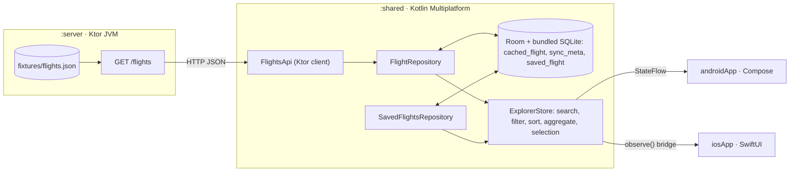
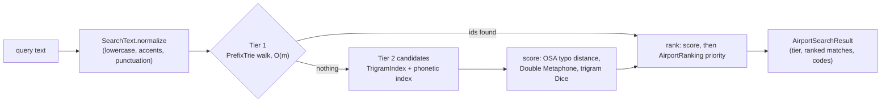

# Architecture

**Principle: shared decides, platforms draw.** Everything with a rule lives once in KMP: fetching, caching, search, filters, ordering, map grouping, selection, saved flights, and the offline state. SwiftUI and Compose render one immutable `ExplorerState` and send intents back. If a platform UI contains an `if` about flight data, that logic belongs in `shared`.

## 1. System overview



## 2. Modules

| Module | Kind | Contents |
|---|---|---|
| `:server` *(new)* | Kotlin/JVM app (Ktor server + `application` plugin) | `GET /flights` |
| `:shared` | KMP library: Android library + static `Shared.framework` | Domain, data, presentation state |
| `:androidApp` | Android app (Compose, Material 3) | UI only |
| `iosApp/` | Xcode project (SwiftUI, iOS 17, Swift 6) | UI only. Its build phase runs `./gradlew :shared:embedAndSignAppleFrameworkForXcode`. |

KMP targets are the existing `android`, `iosArm64`, `iosSimulatorArm64` and `iosX64`, **plus a new `jvm()`**. The JVM target only exists so that `./gradlew :shared:jvmTest` runs on any OS, with an in-memory SQLite driver, and so the oracle test can use the original Java library. It is never shipped.

## 3. Shared package layout

```
shared/src/
  commonMain/kotlin/travel/roame/takehome/
    model/          Flight, Airport, FlightFilters, FilterOptions, ActiveFilter, FetchError
    domain/         FlightFilter, FilterOptionsBuilder, Ordering, MapAggregator, ActiveFilters, GreatCircle,
                    PointsFormat                       ← pure functions, no IO, no coroutines
    domain/search/  AirportSearchEngine, PrefixTrie, Similarity (trigrams, edit distance),
                    SearchText, AirportRanking         ← implemented (§4.4)
    vendor/commonscodec/  DoubleMetaphone              ← third-party port (Apache-2.0), see §4.4
    data/remote/    FlightsApi, FlightsEnvelopeDto, FlightDto, error mapping
    data/local/     AppDatabase, entities, FlightCacheDao, SavedFlightDao (Room, §5)
    data/           FlightRepository, SavedFlightsRepository (interfaces + impls)
    presentation/   ExplorerStore, ExplorerState, FlightItem, SavedFlightItem,
                    DestinationMarker, DataStatus, UserMessage
    di/             AppGraph                            ← the single composition root
  androidMain/      Room database builder (file path from Context), OkHttp engine
  iosMain/          Room database builder (Documents dir), Darwin engine, ios/ExplorerStoreIos.kt (Swift bridge)
  jvmMain/          isConnectivityFailure for the test-only target; tests build their own databases
shared/schemas/     Room's exported schema JSON (version 1)
  commonTest/       rule tests, fakes, builders
  jvmTest/          fixture contract tests; DoubleMetaphoneOracleTest (port vs the commons-codec jar); real OkHttp failures
  iosTest/          real Darwin failures; the app's database file
```

## 4. State & data flow

### 4.1 State

Steps 3.3 to 3.5 built all of this. `resultCount` is `results.size`, so the two can't disagree (C1).

```kotlin
data class ExplorerState(
    val data: DataStatus,                 // Loading | Unavailable(error) | Ready(lastSuccessAt, isRefreshing, refreshError?)
    val originQuery: String,
    val destinationQuery: String,
    val originSuggestions: List<AirportSuggestion>,      // S14: city + codes + isCityRow, at most 5 rows
    val destinationSuggestions: List<AirportSuggestion>,
    val filters: FlightFilters,           // dateStart?, dateEnd?, cabin?, maxPoints?, programs: Set<String>
    val options: FilterOptions,           // date bounds, points bounds, cabins, programs (from the whole cache, F8)
    val activeFilters: List<ActiveFilter>,
    val hasAnythingToReset: Boolean,
    val results: List<FlightItem>,        // search → filter → sort (O1), isSaved resolved (V3)
    val markers: List<DestinationMarker>, // from `results` (M1); each carries its flights in O2 order
    val selected: FlightItem?,            // discovery selection, shared by list and map (L1)
    val saved: List<SavedFlightItem>,     // O3, ignores filters (V8), has isListed flag (V4)
    val savedSelected: SavedFlightItem?,  // L7
    val pendingWriteIds: Set<String>,     // save/remove in flight → disable button (V7)
    val messages: List<UserMessage>,      // one-shot errors; the UI calls messageShown(id)
    val originHint: List<AirportSuggestion>,      // S13: every fuzzy match, in ranked order; empty for any other tier
    val destinationHint: List<AirportSuggestion>,
    val originPick: AirportSuggestion?,           // S14: the tapped row; the app shows "Tokyo (HND)" while it's set
    val destinationPick: AirportSuggestion?,
    val isLocationShared: Boolean,                // D16: a location was set. Unused on screen since D30 removed ⌖
    val landing: Landing,                         // B5–B8: homeAirport?, offers (one per program), destinations (≤ 30); ignores search and filters
)
```

`DataStatus` encodes the offline rules directly:

- `Loading`: nothing has ever synced and there's no failure to report, including during a retry from the error screen.
- `Unavailable(error)`: nothing has ever synced and the fetch failed. The UI shows a full-screen error (R7).
- `Ready(lastSuccessAt, isRefreshing, refreshError)`: at least one sync has succeeded. An empty `results` list here means either "synced empty" (R4) or "filtered empty", and the UI tells them apart by checking whether the cache itself is empty (`options.isEmpty`).

### 4.2 Intents (store API)

| Group | Methods |
|---|---|
| Search | `setOriginQuery(text)` and `setDestinationQuery(text)`, which also clear that field's pick; `pickOrigin(codes)` and `pickDestination(codes)`, passing a suggestion's codes; `swapSides()` (S15); `setUserLocation(latitude, longitude)`, only once the user has allowed location (D16, D32) |
| Filters | `setDateRange(startIso?, endIso?)`, `setCabin(cabin?)`, `setMaxPoints(points?)`, `toggleProgram(name)`, `clearFilter(kind)`, `resetAll()` |
| Sort | `setSort(sort)`, one of `SortOrder`'s entries (D46). The state carries `sort` and `sections`: one per program under By program, otherwise one untitled section (O1). The sort isn't a filter, so `resetAll()` keeps it (O4) |
| Selection | `select(flightId?)`, `selectSaved(flightId?)`. Selecting the selected flight again deselects it (L2) |
| Landing page | `openDestination(codes)` and `openOffer(flightId)`: each starts a new search for a deal, and an offer is selected (B9) |
| Saved | `toggleSave(flightId)` for a flight in the results, `removeSaved(flightId)` for the Saved view. Each flight has at most one write at a time (V7) |
| Data and messages | `refresh()`, `messageShown(id)` |

Every intent is a plain, non-suspending function, so it is easy to call from Swift. Intents that need IO launch work in the store's scope.

### 4.3 Pipeline

```kotlin
private val inputs = MutableStateFlow(ExplorerInputs())  // queries, filters, selection ids, pending ids, messages

val state: StateFlow<ExplorerState> = combine(
    flightRepository.cache.map(::index),  // CacheSnapshot → IndexedFlights: O1 and O2 orders and normalised search keys computed once
    flightRepository.syncStatus,          // isRefreshing + the latest error, which stays during a retry (R11)
    savedRepository.saved,                // Flow<List<SavedFlight>>, added in Step 3.4
    inputs,
) { cache, sync, saved, input -> Snapshot(cache, sync, saved, input) }
    .mapLatest(::reduce)                  // pure; cancelled if newer input arrives → latest wins (PERF-3)
    .onEach(::keepDropped)                // F8, L3, L7: write dropped filter values and stale selections back to inputs, so they stay dropped
    .flowOn(Dispatchers.Default)
    .stateIn(scope, SharingStarted.Eagerly, ExplorerState.Initial)
```

- `reduce` is a pure function, so it can be unit-tested without coroutines. On 1,000 flights with no filters, it takes 1.1–1.7 ms on a Mac JVM and 10–11 ms on the iOS simulator's debug build, excluding text search, and it runs off the main thread. So search needs no debounce. Add a debounce of about 100 ms only if profiling shows a problem. Android isn't measured yet.
- The search index and the two sorted lists (O1 for results, O2 for marker flights) are rebuilt only when the cache emits, never on each keystroke. Filtering keeps their order, so `reduce` doesn't sort.
- `Dispatchers.Default` keeps the CPU work off the main thread. `stateIn` hands the result to collectors.

### 4.4 Search engine

**Status:** implemented and tested in `shared`, and connected to the store in Step 3.5. Each side's engine is built when the cache changes. The screens come in Phases 4 and 5. The rules are in DOMAIN_RULES §2 and §2b. The design is the owner's (D11–D19); Claude proposed the numbers in D19.



| Component | Role | Cost |
|---|---|---|
| `SearchText` | One normalisation shared by the query and the index (S1) | O(query length) |
| `PrefixTrie` | Node-by-node walk with airport ids precomputed per node; `completions()` for autocomplete (S4) | Lookup O(m); memory O(total length of the keys) |
| `TrigramIndex` | Inverted index trigram → terms; Dice similarity from shared counts (S9) | O(trigrams in the query × posting length) |
| `editDistance` | Optimal String Alignment with an early exit once over budget (S7) | O(len²) on candidates only |
| `DoubleMetaphone` (vendored) | Phonetic codes, primary + alternate, length 6 (S8) | O(len) per word, precomputed for the index |
| `AirportRanking` | Proximity + volume priority per airport, with the `flights.json` fallback (P1–P6) | Precomputed per airport; an O(1) lookup |
| `AirportSearchEngine` | Builds the indexes once per dataset and side; `search()` has no side effects | — |

**Data sources for ranking.**
- **Passenger volume** comes from `fixtures/airports.json` (`{"airports":[{"code","annualPassengers"}…]}`). A copy ships inside the app as a Kotlin data file (`domain/search/AirportPassengers.kt`, added in PLAN Step 3.5), so ranking is the same online and offline and needs no endpoint or table. `FixtureContractTest` keeps the copy equal to the file. An airport with no figure uses its flight count from `flights.json` (P4).
- **User location** comes from the device (D16): Fused Location Provider on Android, Core Location on iOS, at approximate accuracy. Platform code reads one fix and passes its latitude and longitude to `setUserLocation` (`UserLocation` on both platforms). Since D32 it is asked for when the app first opens (Step 4.7 first used a "Use my location" button, and D30 the first focus of From). The same point picks the landing page's home airport (B5). The shared code only ever sees an optional point; `null` means ranking by volume only, and the destination field ignores the point (P5). There is no geo-IP endpoint and no third party.

**Third-party code.** `vendor/commonscodec/DoubleMetaphone.kt` is a Java → Kotlin translation of Apache Commons Codec 1.23.0 (Apache-2.0). It is **not our own algorithm**: we didn't design it and don't claim to understand every rule in it. Its correctness is established by the `jvmTest` oracle, which compares it with the original jar. See SUBMISSION_NOTES §8 and THIRD_PARTY_NOTICES.md.

## 5. Persistence (Room, D3)

The owner chose **Room** (Google's database library, multiplatform since 2.7), running on its **bundled SQLite** (`BundledSQLiteDriver`). Every supported Android version (8 and up) and iOS therefore runs the *same* modern SQLite build. Behaviour, and bugs, reproduce identically on every device, and modern SQL (`ON CONFLICT … DO UPDATE`, full-text search) is available everywhere.

The database file is `roame.db`, at schema version 1, with no migrations. Room writes a JSON description of the schema to `shared/schemas/` (for future auto-migrations).

### 5.1 Tables (entities)

```kotlin
data class FlightColumns(       // both flight tables embed this, so they can't drift apart
    val id: String,
    val origin: String, val originCity: String, val originLat: Double, val originLon: Double,
    val destination: String, val destinationCity: String, val destinationLat: Double, val destinationLon: Double,
    val departureDate: String,   // ISO yyyy-MM-dd
    val program: String,
    val points: Int,
    val cabin: String,
)

@Entity(tableName = "cached_flight", primaryKeys = ["id"])
data class CachedFlightEntity(@Embedded val flight: FlightColumns)

@Entity(tableName = "saved_flight", primaryKeys = ["id"])
data class SavedFlightEntity(@Embedded val flight: FlightColumns, val savedAt: Long)   // epoch millis

@Entity(tableName = "sync_meta", primaryKeys = ["id"])   // single row (id = 0); absent = never synced (R8)
data class SyncMetaEntity(val id: Int = 0, val lastSuccessAt: Long)
```

### 5.2 Access objects (DAOs) and transactions

```kotlin
@Dao
abstract class FlightCacheDao {
    @Query("SELECT lastSuccessAt FROM sync_meta WHERE id = 0") abstract fun observeLastSuccessAt(): Flow<Long?>

    /** One transaction, so the flights and the timestamp always come from the same refresh. */
    @Transaction
    open suspend fun read(): CachedRows = CachedRows(getAll(), getLastSuccessAt())

    /** R3 + V5: one transaction, so a failure partway leaves the cache and saved flights as they were. */
    @Transaction
    open suspend fun replaceAll(flights: List<CachedFlightEntity>, now: Long) {
        deleteAll()
        insertAll(flights)
        refreshSavedDetails()
        upsertMeta(SyncMetaEntity(lastSuccessAt = now))
    }

    /** V5: only flights that are both saved and in the new cache change, and they keep their savedAt. */
    @Query("""
        INSERT OR REPLACE INTO saved_flight (/* every flight column */, savedAt)
        SELECT /* c.every flight column */, s.savedAt
        FROM saved_flight AS s JOIN cached_flight AS c ON c.id = s.id
    """)
    protected abstract suspend fun refreshSavedDetails()
    // getAll / getLastSuccessAt / deleteAll / insertAll / upsertMeta: @Query / @Insert / @Upsert
}

@Dao
abstract class SavedFlightDao {
    @Query("SELECT * FROM saved_flight ORDER BY departureDate, id")
    abstract fun observeAll(): Flow<List<SavedFlightEntity>>

    /** V2 / OFF-6: one row per id; re-saving updates the details but keeps the original savedAt. */
    @Transaction
    open suspend fun save(saved: SavedFlightEntity) {
        val existing = findById(saved.flight.id)
        upsert(saved.copy(savedAt = existing?.savedAt ?: saved.savedAt))
    }
    @Upsert protected abstract suspend fun upsert(saved: SavedFlightEntity)
    @Query("SELECT * FROM saved_flight WHERE id = :id") protected abstract suspend fun findById(id: String): SavedFlightEntity?
    @Query("DELETE FROM saved_flight WHERE id = :id") abstract suspend fun remove(id: String)
}
```

- **Reads** are `Flow`s, so the UI updates whenever a table changes. This is what makes "no optimistic UI" (V7) possible.
- **The cache flow** watches `sync_meta`, which every refresh writes, then calls `read()`. Tests in Step 2.2 showed why. Observing the two tables separately gives results that mix two refreshes. So does reading them without a transaction: on a real file, 36 of 373 observed results mixed two refreshes without it, and 0 of 394 with it.
- **Writes** are `suspend` functions. The database runs them on `Dispatchers.IO` (`setQueryCoroutineContext`), so they never block the main thread. Failures surface as exceptions that the repositories turn into `Result` (V7).
- With Room's multiplatform support, DAO functions must be `suspend` or return `Flow`. Blocking DAO calls are Android-only, so we never use them.

### 5.3 Database and per-platform builders

```kotlin
// All of this is `internal`, so none of it reaches the Swift header.
@Database(entities = [CachedFlightEntity::class, SavedFlightEntity::class, SyncMetaEntity::class], version = 1)
@ConstructedBy(AppDatabaseConstructor::class)          // lets iOS/JVM find Room's generated code
abstract class AppDatabase : RoomDatabase() {
    abstract fun flightCacheDao(): FlightCacheDao
    abstract fun savedFlightDao(): SavedFlightDao
}
expect object AppDatabaseConstructor : RoomDatabaseConstructor<AppDatabase>   // filled in by Room's generator

// commonMain: the only shared setup
fun RoomDatabase.Builder<AppDatabase>.configure(): AppDatabase =
    setDriver(BundledSQLiteDriver()).setQueryCoroutineContext(Dispatchers.IO).build()
```

Only the **file location** differs per platform:

- Android: `Room.databaseBuilder<AppDatabase>(context.applicationContext, "roame.db")`. Pass the name, not `getDatabasePath(…)`: resolving the path touches the disk, and this runs on the main thread (StrictMode, Step 4.1)
- iOS: `Room.databaseBuilder<AppDatabase>(name = <Documents dir>/roame.db)`
- Tests (JVM): `Room.inMemoryDatabaseBuilder<AppDatabase>()`, or a temp file for the "survives reopen" tests. These builders exist per platform and aren't visible from `commonTest`, so tests reach them through an `expect` function, with `actual`s in `jvmTest` and `iosTest`

### 5.4 Build setup (proven in PLAN Step 0.2)

- Plugins: `com.google.devtools.ksp` (Room's code generator) and `androidx.room` (with `room { schemaDirectory("$projectDir/schemas") }`).
- Dependencies: `androidx.room:room-runtime` and `androidx.sqlite:sqlite-bundled` in `commonMain`.
- `room-compiler` is registered with KSP once **per target**: `kspAndroid`, `kspIosArm64`, `kspIosSimulatorArm64`, `kspIosX64` and `kspJvm`.
- **Versions (D21):** Room 2.8.5 with `sqlite-bundled` 2.6.2, the SQLite library version Room 2.8.5 is built against. Don't raise `sqlite-bundled` on its own: 2.7.0 and later publish no `iosX64` target, and neither does Room 3.0.3 (`androidx.room3`).
- **Checked on 2026‑11‑01** with Kotlin 2.4.21, AGP 9.3.1 and Gradle 9.7. A throwaway database using every DAO shape in §5.2 passed its tests on the JVM and the iOS simulator. It then ran inside the real apps on the Android emulator (API 37) and the iOS simulator. All of them reported **SQLite 3.50.1**. The throwaway code was then deleted.
- The bundled SQLite is compiled into the app: 1.16–1.31 MB per CPU architecture (measured, the `libsqliteJni.so` files in the debug APK). Play Store users download only their own architecture's copy. The cost is fixed, so it stays the same at 10× and 100× the flights. The iOS app needs **no** `-lsqlite3` linker flag: all three iOS frameworks link without it.

## 6. Networking & the local API

### 6.1 Contract

`GET /flights` returns `200 application/json` with `{"flights": [Flight…]}`. The field names match the fixture exactly (camelCase).

### 6.2 Server (`:server`)

- Ktor server on its CIO engine, listening on `0.0.0.0:8080`. It only needs plain HTTP, so Netty's HTTP/2 support would go unused. The port can be overridden with the `PORT` env var.
- Each request reads `fixtures/flights.json` and returns **the raw bytes**, with no re-serialisation, so the response is byte-identical to the fixture (API-1). Reading on every request means you can temporarily edit the fixture while the server runs to test refresh, R4, V4 and V5.
- The fixture path is `fixtures/flights.json`, relative to the repo root, so set `tasks.named<JavaExec>("run") { workingDir = rootDir }`. If the file is missing, fail fast at startup.
- Request logging uses Ktor's `CallLogging` plugin, with `slf4j-simple` to print it, because the plugin has no output without a logging backend.

### 6.3 Client (`FlightsApi`)

- A Ktor `HttpClient` with these plugins:
  - `ContentNegotiation(json { ignoreUnknownKeys = true })`
  - `HttpTimeout(connect = 5s, request = 15s)`
- `expectSuccess = false`; the status code is checked explicitly.
- Engines: OkHttp on Android, Darwin on iOS, and `MockEngine` in tests. The caller passes the engine in, and `AppGraph` does this in Step 3.3.
- `FlightsApi` is an interface, so the store's tests can use `FakeFlightsApi`. `KtorFlightsApi` is the real one. `fetchFlights()` returns `FetchResult.Success(flights)` or `FetchResult.Failure(error)`, and only cancellation is thrown.
- Exceptions are mapped to `FetchError` (R9), checked in this order, because on the JVM and Android every timeout is also an `IOException`:

  | Cause | `FetchError` |
  |---|---|
  | `CancellationException` | **rethrown, never mapped** (R12) |
  | `HttpRequestTimeoutException`, `ConnectTimeoutException`, `SocketTimeoutException` | `Timeout` |
  | Connection refused, unreachable host, DNS failure, no network, or a connection lost partway through. Detect this per platform with `expect fun Throwable.isConnectivityFailure()`: Android uses `java.io.IOException`, iOS uses `NSURLErrorDomain` codes such as -1004 and -1009. | `Offline` |
  | `ContentConvertException` (Ktor wraps every JSON error, including a missing field, in this), `NoTransformationFoundException` (a 2xx that isn't JSON), `IllegalArgumentException` (a bad date) | `InvalidData` |
  | Anything else | `Unknown` |
  | No exception, but a non-2xx status | `Server(status)` |

  What real failures looked like in Step 2.1, on real sockets (OkHttp on the JVM, not on an Android device; Darwin in the iOS simulator):

  | Failure | OkHttp | Darwin | `FetchError` |
  |---|---|---|---|
  | Connection refused | `ConnectException` | -1004 | `Offline` |
  | Unknown host | `UnknownHostException` | -1003 | `Offline` |
  | Connection closed with no response | `IOException` | -1005 | `Offline` |
  | Connection lost partway through the body | `ClosedByteChannelException` | -1005 | `Offline` |
  | Server never answers, or stalls partway through the body | `HttpRequestTimeoutException` | `HttpRequestTimeoutException` | `Timeout` |
  | Connection stalls | `ConnectTimeoutException` at the connect limit | `HttpRequestTimeoutException` at the request limit, because Darwin ignores connect timeouts | `Timeout` |

### 6.4 Base URL & cleartext HTTP

| Platform | Default base URL | Configured in | Platform setup required |
|---|---|---|---|
| Android emulator | `http://10.0.2.2:8080`, which needs target API 36 or lower (D26) | `BuildConfig.API_BASE_URL` (`buildFeatures { buildConfig = true }`) | Add `<uses-permission android:name="android.permission.INTERNET"/>`, which the starter manifest **lacks**. Add `res/xml/network_security_config.xml` that allows cleartext traffic to `10.0.2.2` and `localhost` only. |
| iOS simulator | `http://localhost:8080` | Info.plist key `API_BASE_URL` | Add `NSAppTransportSecurity › NSAllowsLocalNetworking = YES`. In Step 3.6 the simulator fetched `http://localhost:8080` without it, so Step 5.1 should check whether it's still needed. |
| Physical devices | The Mac's LAN IP | Same keys | Android: add the IP to the network security config. iOS: add `NSLocalNetworkUsageDescription`. |

The platform passes the base URL into `AppGraph`. Shared code never hardcodes a host.

## 7. Concurrency & lifecycle

| Work | Dispatcher |
|---|---|
| Intents and state collection | `Dispatchers.Main.immediate` (the store scope) |
| Reduce, search index, aggregation | `Dispatchers.Default` |
| SQLite reads and writes | Room, on `Dispatchers.IO` via `setQueryCoroutineContext` (`kotlinx.coroutines.IO` on Native) |
| HTTP | Ktor engine threads (`suspend`) |
| JSON decoding | `Dispatchers.Default`, inside `KtorFlightsApi`. Ktor decodes on the caller's thread, which would be the main thread (measured in Step 2.1) |

- `AppGraph` is created **once per process** and owns `CoroutineScope(SupervisorJob() + Dispatchers.Main.immediate)`. Because the store is app-scoped, Android rotation or configuration changes never lose state, and there are no per-screen stores to leak.
- UI observers are the only things that come and go. Compose uses `collectAsStateWithLifecycle`, and Swift cancels its `Cancellable` (§8).
- Tests inject dispatchers and a `Clock`, and use `runTest` with `StandardTestDispatcher`.
- A test using a store on a real database must stop the store and wait for it before closing the database, because `backgroundScope` isn't enough. A read still running on a real thread can otherwise hit the closed database, which crashed the test process in Step 3.3. The apps never close their database while running.
- Debug builds enable Android `StrictMode` (detect disk reads, disk writes and network on the main thread, with `penaltyLog`) to prove PERF-2.

## 8. iOS interop

Kotlin `Flow` and `suspend` functions do not map cleanly to Swift 6. Swift only ever sees one small hand-written bridge in `iosMain`:

```kotlin
// shared/src/iosMain/kotlin/travel/roame/takehome/ios/ExplorerStoreIos.kt
class ExplorerStoreIos internal constructor(private val store: ExplorerStore) {
    val state: ExplorerState get() = store.state.value
    fun observe(onChange: (ExplorerState) -> Unit): Cancellable {
        val scope = MainScope()
        scope.launch { store.state.collect { onChange(it) } }   // delivered on main
        return Cancellable { scope.cancel() }
    }
    fun setOriginQuery(text: String) = store.setOriginQuery(text)
    fun setDateRange(startIso: String?, endIso: String?) = store.setDateRange(startIso, endIso)
    fun setMaxPoints(points: Int) = store.setMaxPoints(points)   // not nullable, so Swift passes a plain Int
    // … one plain method per intent
}
fun interface Cancellable { fun cancel() }
fun createExplorerStore(baseUrl: String): ExplorerStoreIos   // Swift: ExplorerStoreIosKt.createExplorerStore(baseUrl:)
```

```swift
@MainActor @Observable
final class ExplorerModel {
    private(set) var state: ExplorerState
    let store: ExplorerStoreIos
    @ObservationIgnored private var subscription: Cancellable?

    init(store: ExplorerStoreIos) {
        self.store = store
        self.state = store.state
        subscription = store.observe { [weak self] newState in
            MainActor.assumeIsolated { self?.state = newState }   // Kotlin delivers on the main thread
        }
    }
}
```

Rules for the Swift-facing API:

- No default arguments relied on from Swift, no generics, and no `suspend` or `Flow` in public signatures.
- UI models (`FlightItem` and similar) expose primitive-friendly fields: `String`, `Int`, `Double`, `Bool`, and ISO date strings rather than `LocalDate`.
- Sealed types (`DataStatus`, `FetchError`) appear in Swift as class hierarchies. Switch on them with `case let x as DataStatus.Ready`.
- `Shared` is a **static** framework. Room's bundled SQLite is compiled into it, so the app needs no `-lsqlite3` linker flag.
- Optional: use **SKIE** (Touchlab), which gives Swift enums and `AsyncSequence`, but only if a release supports Kotlin 2.4.21. Check that first; otherwise keep the bridge above.

The app calls `createExplorerStore(baseUrl:)` once in `@main struct … : App`, and passes the model down through `.environment(model)`. Built and checked in Step 3.6: the iOS app showed the live flight count from the running API, and again after relaunching with the API stopped.

**The app's files (Step 5.1).** `RoameStarterApp.swift` creates the model from `API_BASE_URL` in `Info.plist` (`http://localhost:8080`, which the simulator reaches on the Mac). `ExplorerModel.swift` holds the state, `ExplorerApp.swift` the tabs and states, `FlightRow.swift` the row, connector and cabin tag, `Format.swift` the dates and counts, and `Theme.swift` the colours. Empty and error states used SwiftUI's `ContentUnavailableView` until Step 6.3a replaced it with the shared `EmptyState`. Dates are built from year, month and day and formatted in UTC, so the device's zone can't shift them (T3). `Info.plist` also has `NSAppTransportSecurity › NSAllowsLocalNetworking`, for cleartext to local addresses, and portrait only (D28). The project lists every Swift file by hand (CLAUDE.md gotchas).

**Search (Step 5.2).** `SearchHeader.swift` mirrors Android: each field keeps the typed text locally and sends every change to the store, follows the store only when it empties the field, shows a pick's label while it's active, and ignores binding writes that change nothing (CLAUDE.md gotchas). Suggestions sit under the focused field, the Search key and scrolling dismiss the keyboard, and autocorrect is off, so fuzzy queries reach the store as typed.

**Filters (Step 5.3).** `FilterBar.swift` has the chips, the summary and the active-filter list, and `FilterSheets.swift` one `.sheet` per filter, with "Show flights" pinned to the bottom. Choices apply as they're made, like Android. Since Step 6.3c the Dates sheet is the app's own calendar (`Calendar.swift`, drawing the shared `DateCalendar`, D41), which works in ISO dates, so the `DatePicker` conversions are gone.

**Selection, card and saved flights (Step 5.4).** Rows select on tap and save with their heart. The card (`FlightCard.swift`) sits in the list's bottom `safeAreaInset`, so the last rows scroll clear of it. Failed writes show as a toast with Retry at the top of the screen, where it can't cover the card's button. A success haptic uses `.sensoryFeedback(.success, …)`, triggered when a write leaves `pendingWriteIds` with no message, as on Android. The Saved tab has a `.badge` with the count.

**Map (Step 5.5).** `ExplorerMap.swift` uses MapKit's `Map`: an `Annotation` pill per destination (VoiceOver reads each one), a geodesic `MapPolyline` for the selected route with a dot at the origin, and the muted, flat standard style (D27 is Android-only; MapKit has no grey style, and Apple's logo and Legal link must stay). The first display uses MapKit's automatic framing; `onMapCameraChange` then records the camera, so later filter changes don't reframe it (M8), and the camera survives switching to the list. On an explicit selection, the camera animates to a region built from the shared `GreatCircle` points, whose unwrapped longitudes handle the antimeridian. The card sits in the map's bottom safe area, which keeps Legal visible and frames routes above the card. Limits: MapKit can't zoom out past about 130° of longitude on an iPhone, so the first view can't show all 24 destinations, and closing the card slides the map by half its height.

**Refresh and offline (Step 5.6, D29).** As on Android, the app refreshes when it opens, and only Try again on the first-load error refreshes otherwise. The stale banner (R6) and the refresh bar (R11) sit under the List | Map switch, and above the message on the "No flights available" screen. The banner formats `lastSuccessAt` in the device's zone with `Format.syncTime` (T4), the same text as Android's. SwiftUI's linear `ProgressView` with no value is a still grey line on iOS, so the bar is drawn by hand: a short accent bar slides along a track in a `TimelineView`, and with Reduce Motion on it fades instead. Cost: while a refresh runs, only that 4-point bar redraws each frame; otherwise nothing.

**One design system (Step 6.3a, D38).** `Theme.swift` holds the palette and the type scale (UI_SPEC §6), the same values as Android's `Theme.kt`. `DesignSystem.swift` holds the shared components (`AppTabBar`, `SegmentedControl`, `AppChip`, the buttons, `AppToast`, `EmptyState`, the page and list rows), each matching a composable of the same name in `DesignSystem.kt`, and `AccountScreen.swift` the Account tab (D39). Details:
- **Shell.** `ExplorerApp` is a `VStack` of the tab's content and `AppTabBar`, with no `TabView`. Explore stays alive under the other tabs, hidden from sight, touch and VoiceOver, so its list position, map and camera survive, as on Android.
- **Font (D40).** Inter's four TTFs are in `iosApp/Fonts/`, listed under `UIAppFonts`. Each style is `Font.custom(_:size:relativeTo:)`, so it scales with Dynamic Type from the text style it stands in for.
- **Icons (D37).** The same 22 Material Symbols as Android, as SVGs in `Assets.xcassets` with vector data kept and template rendering. `MSIcon` draws one with `Image(decorative:)`, so VoiceOver reads the control's label and never the asset's name.
- **Text colour.** `Color.text` (`#302D2A` / `#F2EEE9`, Android's `onSurface`) is set as the foreground style at the root and on each sheet, which SwiftUI presents outside the root, in place of the system's pure black and white.
- **Appearance (D39).** The choice is `@AppStorage("appearance")`, read in `RoameStarterApp` and applied with `.preferredColorScheme`: `nil` for System.
- `CabinLabel` and `ProgramLogo` in `FlightRow.swift` draw the seat-class tag and the program's logo. The logos are bundled PNGs in `iosApp/Logos/`, listed in the project's Resources phase.

Cost: 1.67 MB of fonts and 12 KB of icons in the app, the same on Android; nothing per frame.

**The results (Step 6.3d).** `ResultsScreen.swift`, the same layout and sheet rules as Android's: the sheet's offset is its stop's anchor plus the drag, a `DragGesture` on the header always and on the list only while the sheet isn't full (`including: .subviews` when full), and the list's `ScrollView` is `scrollDisabled` until full. The map's bottom safe area (`safeAreaPadding`) is what the sheet and card cover, which keeps Apple's Legal link visible and frames routes above them; the route is fitted only once the card is measured (`routeToFit`), and once per selection. MapKit lessons from this step:

- Recording the camera on every `onMapCameraChange(.onEnd)` caught MapKit mid-animation and froze a route's framing halfway. So the camera is recorded once, after the first automatic framing, and the user's own moves reach it through the position binding.
- Moving dots couldn't be drawn well (D43). MapKit redraws a `MapPolyline` only when its points change, and scales a line's dashes and its dash phase differently, so the dots crawled and snapped back. The route is now a still dotted line.
- The route is drawn over the map (`RouteLayer`, a `UIViewRepresentable`): MapKit always draws lines under annotations, and the owner asked for the dots to cross the other pills. Its dots, the origin's dot and the plane are Core Animation layers, placed with `MapReader`'s `convert` from a display link every frame while the results show, outside SwiftUI and with touches off. That keeps them on the map while it moves and across the antimeridian; a step longer than half the world starts a new piece of line. A still map with a resting plane isn't redrawn. The selected pill is cut out of it with a mask, measured from a hidden copy of the pill, so MapKit's own pill shows on top.
- Why layers (the owner's review of Step 6.3e): drawn in SwiftUI, and redrawn on every `onMapCameraChange(.continuous)` and every plane frame, the route held up the map's own drags. On the owner's iPhone they only took hold on the line. On the simulator a drag moved the map 44% as far as the finger; without the camera listener 63%, without the plane's redraws as well 88%, the same as with no route at all. With layers it's 88%, and the app uses 2–5% CPU while the plane flies (3–11% before).
- Moved every frame as an `Annotation`, MapKit placed the plane unevenly, and the app used 25–55% CPU on the simulator. Annotations moved inside `withAnimation` left the route.
- The selected destination is the map's own selection, which MapKit draws above the other pills (M4). A tap that MapKit takes as a selection opens that pill's flights, and the selection goes back.
- Pills are centred on the airport, as Android's are, and `fixedSize`, because MapKit offered them too little width and cut off the count. Routes are framed with an `MKMapRect` built from the shared points, which crosses the antimeridian as one rectangle.

**The search page (Step 6.3c).** `SearchScreen.swift`, the same steps and layout as Android's, made fresh each time it opens. The pickers reuse `SearchField`, which now takes outside changes to its text the way Android's does, and focuses a quarter of a second after appearing, or the keyboard may not come up. The calendar is `Calendar.swift`.

**The landing page (Step 6.3b, D36).** `LandingScreen.swift`, the same layout and sizes as Android's. `ExplorerApp` keeps it and the results alive in its `ZStack`, hidden from sight, touch and VoiceOver when not shown, so each keeps its state. Its horizontal rows carry `.id(homeAirport)`, so new deals start from their first card, as on Android. The scroll view is `.clipped()`, because otherwise its content draws under the status bar when scrolled (found in QA). Photos are `dest_*` image sets in `Assets.xcassets`, looked up by the shared photo key; a missing one gets the drawn card.

**Dark mode (Step 5.8).** System colours adapt by themselves. The accent is the app's own colour, so `Theme.swift` gives it a dark-mode value, Android's dark `primary` (`#AFC6FF`), because the deep blue was too dark to read as text on dark grey (about 1.8:1). Text and icons on an accent fill use `Color.onAccent`, white or Android's `onPrimary` (`#002D6C`). MapKit switches to its dark map by itself; since D45 the map is held light (`.environment(\.colorScheme, .light)`), with its pills, route and plane, as Android's always-light map is. Since Step 6.3a the colours are Roame's, and every one is the app's own with a dark value (UI_SPEC §6); the user can also fix light or dark in Account › Settings.

**Location (Step 5.7, D16; asked at launch since Step 6.3b, D32).** `UserLocation.swift` wraps a `CLLocationManager`, made once at launch in the tab view's `.task`. Core Location reports the current permission when the manager is made:
- If iOS hasn't asked yet, it calls `requestWhenInUseAuthorization()`, so the dialog shows as the app opens.
- If allowed, now or after the dialog, it reads one location with `requestLocation()` and passes it to the store's `setUserLocation`.
- After a denial it does nothing. iOS won't show the dialog twice anyway.

So a permission granted on an earlier launch is read straight away without asking. `Info.plist` sets `NSLocationDefaultAccuracyReduced`, so the dialog offers approximate location only (no Precise switch), matching Android's coarse permission. It also sets `NSLocationWhenInUseUsageDescription`, the reason the dialog shows. A missing fix or an error changes nothing and shows nothing. Callbacks arrive on the main thread, because the manager is made there. Cost: one reading per launch at most, and no background location.

For QA, `xcrun simctl location <udid> set <lat>,<lon>` sets the simulator's location, and `xcrun simctl privacy <udid> reset location <bundle id>` makes the app ask again (TEST_PLAN §3).

## 9. Android integration

- `RoameApp : Application` builds `createAppGraph(this, BuildConfig.API_BASE_URL)` lazily, on first use. Register it in the manifest.
- Screens read `app.graph.store.state.collectAsStateWithLifecycle()`.
- Each search field keeps the text being typed in Compose and sends every change to the store. It doesn't read the store's copy back while typing, because state arrives a moment later and a fast typist would lose letters. It only follows the store when the store empties it (Reset). Matching, suggestions and picks still come from the store.
- Filter sheets apply each choice as it's made, so "Show flights" just closes the sheet. Since Step 6.3c the Dates sheet is the app's own calendar (`Calendar.kt`, drawing the shared `DateCalendar`, D41), so Material's date picker and its UTC millis, and the test that checked their conversion, are gone.
- The selection card lies over the bottom of the list. The list pads its end by the card's measured height, so the last row can scroll clear of it. Failed writes arrive as `UserMessage`s and show as an `AppToast` with Retry at the top of the screen, where it can't cover the card's button (since Step 6.3a; before, a snackbar). The success haptic fires when a write leaves `pendingWriteIds` with no message, because the store has no success event (UI_SPEC §5).
- **The map (Step 4.5; D8, D23, D24):**
  - A MapLibre `MapView` in `AndroidView`. It's made the first time the results show (before Step 6.3d, the first time Map was chosen), so the landing page alone never loads it. After that it's never detached from the window (D31): it's kept in a `MapHolder`, with its style and listeners, and stays in place, invisible, paused and stopped, while the landing page, the search page or another tab is shown. The Explore screen also stays composed while the Saved tab is shown, measured but not placed, so nothing of it is drawn, tapped or read by TalkBack. The map is destroyed only with the activity. While shown, it follows the screen's lifecycle; a flight chosen in the list while it's hidden doesn't move its camera, as before.
  - Starting MapLibre reads the disk three times: loading its native library, finding its cache folder, and finding the app's files folder for its default options. So when Map is chosen, a background thread does all three first (`LibraryLoader.load()`, `FileSource.getResourcesCachePath`, `MapLibreMapOptions.createFromAttributes`). MapLibre keeps each result, and the `MapView` is then made on the main thread with those options. StrictMode reports nothing (Step 6.1). Cost: the map appears a moment later the first time, about the library's load time (248 ms on the emulator).
  - MapLibre expects `onPause` before `onStop`, and both before `onDestroy`; `MapHolder` keeps that order and never repeats a call.
  - **Why D31 (Step 6.1):** every time a MapLibre `MapView` is made, or detached from the window and attached again, about 4–7 MB of native memory stays behind. Over 18 opens of the map, that was 11 → 141 MB with a new map each time, and 11 → 113 MB with one map that was detached each time. Kept attached, it measured 53.1, 53.4 and 53.6 MB after 6, 12 and 18 opens, and 54.1 → 54.7 MB over 7 trips to Saved and back. Leaving the app with Home and returning, which also rebuilds the map's surface, leaked nothing. Cost: once opened, one map's memory (about 42 MB of native memory on the emulator) stays while the list or Saved is shown. It doesn't grow with switching or with the data.
  - The choice of List or Map, the list's position and the map's camera live above both tabs in `rememberSaveable` state, so tab switches and rotation keep them (M8). The first display fits every marker; after that, the saved camera is restored.
  - Pills are one `SymbolLayer`. Each pill is a bitmap with its text drawn in, so no fonts are downloaded, and one bitmap is made per distinct label. The selected destination gets an accent pill and a higher `symbolSortKey`, so it draws on top (M4).
  - The route is a `LineLayer` over `GreatCircle.interpolate` points, whose unwrapped longitudes also give the bounds to fit across the antimeridian. Fitting pads the bottom by the selection card's height.
  - If the style hasn't loaded after 10 s, "Can't load the map" replaces the map, with Retry (D24). The app's own timer decides, because MapLibre's failure event isn't reliable (Step 0.3).
  - Cost: one bitmap per distinct pill label seen in the session, kept in the map's style (24 at the start; filters that change counts or lowest points add more, each a few tens of KB). The markers source is rebuilt on every results change, O(markers). The plan for more markers is in UI_SPEC §10.
- **Refresh (Step 4.6, D29):** the app refreshes when it opens, and only Try again on the first-load error refreshes otherwise. While `Ready.isRefreshing`, a `LinearProgressIndicator` sits over the data (R11). The stale banner formats `lastSuccessAt` in the device's zone (T4), and `SyncTimeTest` checks that in three zones and across local midnight.
- **The "Fail next DB write" hook (TEST_PLAN §6):** `AppGraph` wraps the saved-flights repository in `FailNextWriteSavedFlights`, and `failNextSavedWrite()` makes the next save or remove fail once, without touching the database. The method exists in every build of the shared library. Only debug builds of the Android app call it, from a long-press on the card's "Selected flight" title, and iOS reaches it through `ExplorerStoreIos.failNextSavedWrite()` under `#if DEBUG`, from the same long-press (Step 5.4). Cost: one atomic flag check per write.
- **One design system (Step 6.3a, D38):**
  - `Theme.kt` sets a full Material colour scheme from Roame's palette, `ExtraColors` for the brand pink, the gradient and the seat classes, and the Inter type scale (D40, `res/font/`). It also makes `onBackground` the default content colour: with no `Scaffold` or `Surface` at the root, text drawn straight on the background was Compose's default black, unreadable in dark mode (found in this step's QA).
  - `DesignSystem.kt` holds the shared components, each matching a view of the same name in `DesignSystem.swift`, and `AccountScreen.kt` the Account tab (D39). Material's own `NavigationBar`, `SegmentedButton`, `FilterChip` and `Snackbar` are no longer used. The tab bar's spoken label carries the badge's count, which Material's hid (Step 4.4 finding).
  - The appearance setting (`Appearance.kt`) is kept in `SharedPreferences`. `RoameApp` reads it on a background thread at launch, so the first frame has it without a main-thread disk read; a change is written with `apply()`. `MainActivity` passes it to `RoameTheme` and sets the system bars' icon colour to match.
  - `CabinLabel` and `ProgramLogo` are in `FlightRow.kt`. Icons are 22 Material Symbols copied into `res/drawable/ms_*.xml` (D37); the logos are PNGs in `res/drawable-nodpi/`. StrictMode logs nothing from loading the fonts or icons.
- **The results (Step 6.3d, D36):** `ResultsScreen.kt`: the header (back, the search pill, Filters), the active-filter chips, and a `BoxWithConstraints` with the map filling it and the list as the app's own sheet over it. The sheet's position is one `Animatable` between three anchors (peek 64 dp, half, full); a drag `snapTo`s it and a release `animateTo`s the nearest anchor or the next one past a fling, and a new animation cancels a running one. While not full, a `draggable` on the whole sheet moves it and the `LazyColumn` doesn't scroll; when full, only the header drags. A new selection sets the anchor to peek. The card is placed above the sheet by its measured height, and the map gets the covered height as its bottom inset, with `insetReady` so a route is fitted only once the card is measured. The map is made the first time the results show, then kept (D31), and stays composed under the other pages. `FiltersSheet` (in `FilterSheets.kt`) has every filter, and the dates as a step inside it.
- **The map's first display (Step 6.3d's review):** made inside the results, the map stayed blank until the app went to the background and back. Logging showed MapLibre started and resumed but never ready, because Android never created its `SurfaceView`'s surface (SurfaceFlinger had no layer for it). The map now follows the lifecycle from its first layout with a size, and hides and shows itself once, which makes Android create the surface; it was then ready within 40 ms. The re-show is skipped if the map was hidden meanwhile.
- **The route (M9, D43):**
  - The line is a still dash pattern: 5.5 dp dots, 2.9 widths apart, to match iOS's. (Stepping the dash pattern had drawn a fixed extra dot, because a zero-length leading dash with round caps is a dot.)
  - The plane is a `SymbolLayer` with a bitmap drawn from `ms_flight`, rotated by the shared heading with map alignment, with its opacity from a feature property. Rotation and tilt gestures are off.
  - While a route shows and the map is visible, a `LaunchedEffect` loops on `withFrameMillis` and sets the plane's source to `PlaneFlight`'s frame. Under Reduce Motion it's set once, halfway. Cost: one one-point GeoJSON update per frame while a route shows, and nothing otherwise.
  - Layers, bottom to top: the other pills, the route, the origin's dot, the selected pill (M4), the plane. The pills are two symbol layers on one source, filtered by selection, so the dots cross the other pills and end under the selected one.
- **Pills (D44):** each pill is a bitmap drawn on a `Canvas` in Inter, laid out as iOS's `MarkerPill`. Each image is named by what it shows: the code, count, selection, font scale and colours. Images that neither of the last two marker updates used are removed, so filtering doesn't pile them up: at most two updates' worth, about 50 images of roughly 100 KB each. The colours and the font scale are effect keys, so the pills follow the appearance setting.
- **The search page (Step 6.3c, D36):** `SearchScreen.kt`, shown when the search bar or the banner's button is tapped, and made fresh each time, so it opens on its form. Its steps (the form, the From and To pickers and the dates) are a saveable enum with one `BackHandler`, so back leaves a step first, then the page. The pickers reuse `SearchField` with focus on arrival. A field now takes any text from the store that it didn't type itself (a swap, a deal, Reset), while still ignoring the store's late echoes of its own typing: it remembers what it sent until the store shows the last of it. The results stay composed under it (D31).
- **The landing page (Step 6.3b, D36):** `LandingScreen.kt`. Explore shows it until the search bar, the banner's "Find a flight" or a deal opens the results, which have a Back bar above the existing search and results; back returns to it after a selection's back. The flag is `rememberSaveable`. The results stay composed but unplaced under the landing page, like under the other tabs, so the map is never detached (D31), and the landing page stays composed under the results, so it keeps its scroll position. The deck and offer rows are `LazyRow`s keyed by the home airport, so new deals start from their first card; otherwise a lazy row keeps its first visible item in view when the items reorder, and the new best deal sat off-screen to the left (found in QA). Photos are `res/drawable-nodpi/dest_*.jpg`, looked up through an explicit map from the shared photo key to `R.drawable`, not by name at runtime, so resource shrinking can't drop one.
- The app targets API 36 (D26). Debug builds turn on StrictMode, and a fresh launch logs no main-thread disk or network access (Step 4.1). That needed two fixes: the database builder gets a file name rather than a path, and `KtorFlightsApi` creates its HTTP client on first use, on a background thread, because setting up JSON reads from disk. There is no Android `ViewModel` layer, because the shared store already outlives configuration changes.
- Navigation uses `rememberSaveable` tab state, and Account's pages a `rememberSaveable` page with `BackHandler`. Three tabs and four pages don't need a navigation library.
- Lists use `LazyColumn(items(results, key = { it.id }))`, with stable and immutable models (`@Immutable` where helpful).
- Add these dependencies: `material3`, `lifecycle-runtime-compose`, MapLibre (D8), and `leakcanary-android` (debug only).
- **Location (D16):**
  - Fused Location Provider comes from Google Play services (`com.google.android.gms:play-services-location`), so the emulator needs a "Google Play" or "Google APIs" system image.
  - Declare `ACCESS_COARSE_LOCATION`. Ask for it when the app opens (D32; D30's first focus of From before Step 6.3b), in `UserLocation`, once per launch. It asks only while Android's rationale flag is false, which means not asked before, so a denial is never asked again automatically. Once granted, each launch reads the location without asking.
  - Read one location with `getCurrentLocation(PRIORITY_BALANCED_POWER_ACCURACY)` and pass it to the store as a `GeoPoint`.
  - Built in Step 4.7 with `play-services-location` 21.4.0 (June 2026; needs API 23, adds no permissions). A denial, a missing fix or a failure changes nothing and shows no error, so ranking stays volume-only and the deals come from every airport.
  - Testing: on the API 37 emulator, `adb emu geo fix` didn't reach the location providers. Android's test providers did: allow `android:mock_location` for `com.android.shell` with `appops`, then `cmd location providers add-test-provider`, `set-test-provider-enabled` and `set-test-provider-location` for `gps` and `network`. Remove them afterwards. The emulator's Extended controls › Location also works by hand.

## 10. Libraries

The per-choice tradeoffs (options, strengths, weaknesses, who chose and why) are in [SUBMISSION_NOTES.md §4](SUBMISSION_NOTES.md#4-technical-tradeoffs-by-stack-choice).

Versions are pinned in `gradle/libs.versions.toml`. These were proven together on **Kotlin 2.4.21, AGP 9.3.1 and Gradle 9.7** in Step 0.2: coroutines 1.11.0, serialization 1.12.0, datetime 0.8.0, Ktor 3.6.1, Room 2.8.5, `sqlite-bundled` 2.6.2, KSP 2.3.13 and Turbine 1.2.1.

| Concern | Choice | Why | Fallback |
|---|---|---|---|
| Async | kotlinx-coroutines (+ `-test`) | Standard; `Flow`, `mapLatest`, `runTest` | — |
| JSON | kotlinx-serialization-json (+ plugin) | KMP-native, compile-time | — |
| Dates | kotlinx-datetime `LocalDate` | Calendar dates with no timezone traps | ISO strings, which compare correctly as text |
| HTTP client | Ktor client: core, content-negotiation, okhttp, darwin, mock | The standard KMP client; `MockEngine` for tests | — |
| Database (D3) | **Room KMP** (`room-runtime`, KSP `room-compiler`) + **bundled SQLite** (`sqlite-bundled`) | The same modern SQLite on every Android version and iOS; `@Upsert`, `@Transaction`, `Flow` queries; the Android standard; in-memory JVM tests | SQLDelight (not needed: Room passed Step 0.2) |
| Server | Ktor server (CIO) in `:server`, with `CallLogging` and `slf4j-simple` | Same language and build, so `./gradlew :server:run` is the single command | A ~20-line Node or Python script |
| Flow testing | Turbine | Readable Flow assertions | Collect into lists manually |
| iOS bridge | Hand-written `observe()` wrapper | No dependency on Kotlin-version-specific plugins | SKIE, if compatible |
| iOS map | MapKit for SwiftUI (`Map`, `Annotation`, `MapPolyline(…, contourStyle: .geodesic)`) | Built in, iOS 17, no API key | — |
| Android map (D8, D23, D24) | **MapLibre Native Android** 13.7.1, default Vulkan package (`android-sdk`), with OpenFreeMap tiles in the grey "Positron" style (D27), no API key. Adds 9.2–13.0 MB per CPU architecture (measured), which doesn't grow with the flights | Reviewers can run it with no setup | Google Maps Compose (needs an API key), only with the owner's approval if MapLibre fails |
| Device location *(D16)* | Android: Fused Location Provider (`play-services-location` 21.4.0). iOS: Core Location (built in) | Works offline, no third party | — |
| Leaks | LeakCanary (Android debug), Xcode Memory Graph and Leaks instrument | — | — |
| Phonetic matching | **Vendored** Double Metaphone: a Kotlin port of Apache Commons Codec 1.23.0, Apache-2.0 | No KMP library exists, and commons-codec is JVM-only (no iOS) | — |
| Port verification | `commons-codec:commons-codec:1.23.0`, **test-only** (`jvmTest`) | The original library acts as the oracle for the port | — |
| Other search algorithms | Our own code: trie, trigram index, OSA edit distance, ranking | Small, explainable, tested | — |

## 11. Decision log

The rationale and the rejected alternatives for each decision. **Origin** and **status** match the decision record in [SUBMISSION_NOTES.md §2](SUBMISSION_NOTES.md#2-decision-record). "Claude" means Claude's choice of *how* to meet a brief requirement; it isn't a requirement in itself.

| # | Decision | Origin | Why | Rejected alternatives |
|---|---|---|---|---|
| D1 | The local API is a Ktor JVM module in the same Gradle build | Owner's choice (Claude's recommendation) | A natural fit for a Kotlin Multiplatform project: one language and one command. It reuses the Gradle and JDK setup that already exists. | Node or Python, which add a runtime dependency for reviewers |
| D2 | Share **presentation state** (`ExplorerStore`), not just repositories | Owner's choice (Claude's recommendation) | Selection, map grouping, active filters and offline state then behave identically on both platforms and are unit-tested once. The bridging code should be smaller than writing the same state in both apps. | Separate per-platform view models over shared repositories, which duplicates rules |
| D3 | **Room KMP on its bundled SQLite** | Owner's choice | One identical SQLite build on every phone and on iOS, so behaviour and bugs reproduce the same everywhere; transactions, `@Upsert` and `Flow` queries; familiar to Android reviewers. Accepted risk: KSP/Room support for Kotlin 2.4.21, which Step 0.2 checked and found working (D21) | SQLDelight (visible SQL and the longest multiplatform record, but it uses each phone's own SQLite, whose version varies by device); DataStore or JSON files (no transactions or queries) |
| D4 | Saved flights are snapshots in their own table | Owner's choice (Claude's recommendation) | They survive being missing from the API response (V4) and cache wipes, and refresh never deletes them. The extra storage is minimal (about 98 bytes per saved flight, measured). | A saved-ids table joined to the cache, which loses flights that vanish from the API; one flight table plus saved ids that keeps saved rows on refresh, which is more bug-prone for a minimal storage saving |
| D5 | Replace the whole cache on every successful refresh | Owner's choice (Claude's recommendation) | The API returns the full dataset with no paging or diff, so a full replace is simplest and correct. A diff showed no real speed gain (136 ms vs 130 ms at 100,000 rows, measured on a Mac with Python and SQLite, not Room on a phone). | Merge or diff, which is unnecessary complexity |
| D6 | Filter in memory on `Dispatchers.Default`, not in SQL, sorting once per data change | Owner's choice (Claude's recommendation) | Only 1,000 rows today. Pure functions are easier to test, and there is one code path. Sorting once keeps each input change at 9.6 ms at 100,000 flights, compared with 35 ms when sorting every time (measured on a Mac in Java, excluding text search). | SQL `WHERE` clauses, which are harder to compose and to test for boundaries |
| D7 | A hand-written Swift bridge | Owner's choice (Claude's recommendation) | No plugin coupled to Kotlin 2.4.21. It grows with the number of user actions, not the number of flights, and SwiftUI talks to one class, so replacing it later stays contained. | SKIE or KMP-NativeCoroutines, which carry version risk; Swift export, which is still Alpha |
| D8 | **MapLibre** on Android (MapKit on iOS) | Owner's choice (Claude's recommendation) | Open source with no API key, so the map works for any reviewer. GPU-drawn vector tiles give smooth, sharp rendering, and we don't target low-end phones, so a lighter library buys nothing | Google Maps Compose (mandatory Google Cloud billing account and API key; reviewers without one see a blank map); osmdroid (raster tiles in a classic View, with known visual glitches) |
| D9 | Add a `jvm()` target for tests | Owner's choice (Claude's recommendation); built | `jvmTest` runs on any machine and in CI, with a real SQLite in memory, and it's the only target where the oracle test can use the original Java library. It isn't meaningfully faster than the iOS simulator on a Mac (3–4 s vs 3–6 s after a small code change). | Android host tests, which are expected to be slower and awkward under the new AGP 9 KMP plugin (not measured) |
| D10 | One app-scoped store per process | Owner's choice (Claude's recommendation) | It survives rotation, avoids leaks, and gives one source of truth for list and map. Accepted cost: if Android closes the app in the background, the search text, filters and selection reset; cached and saved flights survive in the database. | Per-screen view models, which risk divergent state |
| D11 | **Tiered search:** walk a prefix tree node by node in O(m); fuzzy only when the prefix tier finds nothing | **Owner** | Predictable while typing; fuzzy never adds noise to good prefix results | A blended score over every signal (it passed the same tests but is less predictable) |
| D12 | **Fuzzy = phonetic + n-gram + accent folding**, built on the owner's four mistyping cases; Claude added an edit-distance typo signal | **Owner** (+ Claude) | Covers typos, sound-alike spellings, partial spellings and accents | Prefix only (no tolerance); Soundex (misses `shicago`, `okland`) |
| D13 | **Double Metaphone comes from a library** (Apache Commons Codec), translated to Kotlin with credit and verified against the jar | **Owner** (a library, disclosed); translation route: owner's choice | No KMP library exists, and the Java one can't run on iOS. A port keeps one shared implementation. | Android-only library (platforms would diverge); our own Metaphone-lite |
| D14 | A **"Showing … (CODE)" hint** when results come from fuzzy matching | Owner's choice | Silent corrections confuse people | A suggestions dropdown (more UI work); silent |
| D15 | **Ranking by location + passenger volume.** Volume lives in a separate `fixtures/airports.json`, a copy ships inside the app, and any airport with no figure falls back to its flight count from `flights.json` | **Owner** | Familiar and nearby airports first, without touching the provided data. Shipping the figures keeps the order the same offline with less to build, and Roame's website also ships its airport data with its scripts | Fetching the figures from `GET /airports` and saving them in a table (more code for yearly figures); editing `flights.json` (rejected: the API must serve it verbatim) |
| D16 | **Location comes from the device** (Fused Location Provider / Core Location), approximate accuracy, only on "Use my location" (changed by D30: asked on the first focus of From) | **Owner** | Works offline (GPS needs no internet), more accurate, no third party, no extra endpoint | Geo-IP through the local API (Claude's earlier proposal): it would locate the developer's machine rather than the user, and needs an outside geo-IP service |
| D17 | **Ranking only orders the matched airports.** The flight list keeps O1 | Owner's choice (option A) | Earlier and cheaper flights are never pushed down; the list order doesn't depend on where you are | Reordering the flight list by airport priority (option B) |
| D18 | Search runs on **airports, not flights**, behind indexes | Owner's choice (follow Roame); built | The brief names Roame as its functional reference, and Roame's website finds the place first and then searches flights for it. The brief's fields also "match airport codes or city names", and the prefix tree, hint, ranking and suggestions all work on airports. Scale is a side benefit: at most 0.56 ms per keystroke at 100,000 flights (measured on a Mac in Java). | Matching each flight's strings: the same results, up to 49 ms at 100,000 flights, and those features would still need an airport list |
| D19 | Ranking weights: origin 0.6 / 0.4, destination 0 / 1, and proximity halves every 250 km | Owner's choice (Claude's recommendation); assumption A13; built | Your location says nothing about where you're flying to, so the destination uses popularity alone, as Amadeus's keyword search, Duffel, AirLabs and Roame's website do. The origin split is Photon's default, and 250 km is the widest range in Google's patent. Both are borrowed, not measured on real usage. | 0.7 / 0.3 and 0.2 / 0.8 with proximity halving every 693 km, chosen by judgement; popularity only in both fields, as on Roame's website |
| D20 | **A suggestions dropdown under each search field**, built from that field's ranked matches in the data, with one extra row when two or more matches share a city | **Owner** (Claude: 5 rows and the tap behaviour, A14) | Search feels live as the user types, and ranking becomes visible. The city row follows Roame, and lets a tap give what typing `tokyo` already gives. The engine already ranks matches on every keystroke, over airports rather than flights, and the 5-row cap keeps the dropdown the same size at 10× and 100× the airports. | The hint alone (D14, which stays); the trie's `completions()`, which has no airport codes or ranking |
| D21 | Room 2.8.5 with `sqlite-bundled` 2.6.2 | Owner's choice (Claude's recommendation) | This is a take-home, and Room 3's benefits are mostly for later development. The starter builds `iosX64`. Room 2.8.5 publishes it and is built against SQLite library 2.6.2, the last version that publishes it. Already tested, with the same SQLite 3.50.1. Moving to Room 3 later is mostly renames, because our DAOs are already `suspend` or `Flow` only | Room 3.0.3, the line Google's KMP setup page now uses: no `iosX64`, so iOS wouldn't build for an Intel Mac simulator, and it needed its own trial run. `sqlite-bundled` 2.7.1: no `iosX64` either |
| D22 | Android 8 (API 26) is the minimum: `minSdk` 26, raised from the starter's 23 | **Owner** | The brief doesn't ask for older versions, and Android 6–7.1 date from 2015–2016. `LocalDate` needs API 26 or extra setup, and with the higher minimum those phones can't install the app, rather than installing it and crashing on the first date | Core library desugaring (one more build library, testable here only on API 37); leaving `minSdk` at 23 (those phones could crash) |
| D23 | MapLibre's default package, which uses Vulkan | Owner's choice (over Claude's recommendation of OpenGL) | It's the package MapLibre's docs tell most apps to use, and they say Vulkan performs better on modern devices. Every Step 0.3 check passed on it. Accepted costs: it needs Vulkan 1.0, the docs call it "newer, some open issues remain", and the debug APK is larger (69.9 MB vs 62.4 MB). Switching is a one-line change | `android-sdk-opengl` (runs on "any device", smaller; Claude's recommendation); `android-sdk-vulkan-opengl` (both, about 10 MB more) |
| D24 | On Android, a map that can't load shows a message with Retry | **Owner** (over drawing markers on a plain background) | The brief says offline applies to flight data and map tiles aren't required, and flights stay available in the list. MapLibre needs its style before it can draw anything, so a map that has never loaded online would otherwise be blank. Once it has loaded, it works offline from its cache. iOS is expected not to need this, because MapKit has no style to download; Step 5.5 checks | Markers on a plain built-in background: Claude's attempt reported success but never drew, so the effort is unknown |
| D25 | No QA switches: the local API only serves `GET /flights` | **Owner** (over Claude's mild preference to keep them) | The brief doesn't ask for them, and no app code or test uses them, because automated tests fake responses with `MockEngine`. This is a take-home, so 46 more lines to explain weren't worth it. By hand, stop the API for a failed request and temporarily edit the fixture for an empty one | Keep `--mode` and `--fixture`: empty and loading screens are easier to see by hand |
| D26 | The Android app targets API 36 (Android 16), not 37 | **Owner** (Claude's recommendation) | Android 17 blocks apps that target API 37 from local network addresses, including the emulator's `10.0.2.2`, unless they hold the runtime `ACCESS_LOCAL_NETWORK` permission. TCP connections just time out. Apps that target 36 or lower keep access automatically and still run on Android 17. Tested in Step 4.1: target 37 timed out, target 36 loaded 1,000 flights | `adb reverse tcp:8080 tcp:8080` with `localhost` (tested; an extra step after every emulator start); asking for the permission (a "Nearby devices" prompt before any flight loads, and nothing loads if it's denied) |
| D27 | Grey map style (OpenFreeMap "Positron") with the MapLibre logo hidden | **Owner** | The owner found the colourful default ugly and asked for grey with no watermark. Grey also lets the pills and the route stand out. Checked on 2026‑11‑03: OpenFreeMap lists Positron among its styles, and its JSON uses greys (background rgb(242,243,240), water rgb(194,200,202)). MapLibre's licence is BSD-2 with no logo clause; OpenFreeMap and OpenStreetMap require attribution, so the ⓘ button stays, lifted above the selection card. One-line change to switch back | "Liberty" (the colourful default from Step 0.3); "Bright"; "Dark" (its URL isn't listed on OpenFreeMap's pages) |
| D28 | Portrait only, on both platforms | **Owner** | In landscape the search header left no room for results. A one-line setting on each platform. Android 16 ignores orientation locks for apps targeting API 36 on large screens (600 dp and wider), so tablets may still rotate; the brief targets phones. Rotation tests (Q21) now cover only tablets, backgrounding and other configuration changes | Make the header scroll away in landscape (more work, and the owner plans to redesign the header in Step 6.3) |
| D29 | No manual refresh | **Owner** (over Claude's recommendation) | The brief asks for failed refreshes to be shown, not for a way to start one, and the data is a static fixture. Removing pull to refresh, ⟳ and the banner's Retry leaves less to explain. Cost: a failed refresh is shown by reopening the app, and the user can't retry without reopening. The store's `refresh()` stays, for launch and Try again | Keep pull to refresh and the Map-mode ⟳ (Claude's recommendation: a standard mobile pattern, and an easy way to show a failed refresh in the demo) |
| D30 | Location asked on the first focus of From, with no ⌖ button | **Owner** | The owner wanted a prompt, not a button. Asking where location helps follows Android's and Apple's guidance to ask in context. Not asking again after a denial respects it, and Android would stop showing the dialog after a second denial anyway. Cost: no on-screen way to share location after denying, other than system settings | Ask when the app first opens (simpler, but asks before the user has done anything); keep the ⌖ button (Step 4.7 as first built) |
| D31 | The Android map is made once and stays attached while hidden | **Owner** (Claude's recommendation) | Every MapLibre map that's made, or detached and attached again, leaves about 4–7 MB of native memory behind (Step 6.1: 11 → 141 MB over 18 opens). Keeping one map and never detaching it held memory flat: about 53 MB after 6, 12 and 18 opens, and after trips to Saved. Switching back to Map is also instant, with no style to reload. Cost: once opened, the map's memory stays while the list or Saved is shown, and the Explore screen stays composed under the Saved tab | Documenting the leak (grows with each switch). MapLibre's OpenGL build instead of Vulkan (a library change that might not help). Keeping one map but detaching it when hidden (tried: still about 4 MB per switch) |
| D32 | Location is asked for at first launch | **Owner** | The owner wants nearby offers on the home screen from the start. Approximate only, and never asked again after a denial, so the cost of asking early is one dialog | Asking on the first focus of From (D30) |
| D33 | Destination photos are bundled | **Owner** (Claude's recommendation) | They work offline, need no service or key, and their licences can be checked once. Cost: about 2–3 MB per app | Downloading them (a third party, blank offline). Drawn cards only |
| D34 | Real program logos where licences allow | **Owner** (Claude's recommendation) | Recognisable, like Roame's. They're trademarks used only to name each program; a file whose licence isn't clear gets a drawn badge | Drawn badges only |
| D35 | Best offer by value score | **Claude** (delegated by the owner) | Points alone favour short hops. Points per 1,000 km against the same cabin's typical rate rewards real value, using only data the app has (DOMAIN_RULES B rules) | Cheapest first |
| D36 | Flights appear only after a search | **Owner** | Roame's structure: a landing page, a search page, then results. The owner reads the brief's "results visible immediately" as a search showing its results at once (A23) | A list on the landing page. A map always available |
| D37 | Material Symbols for the icons, on both platforms | **Owner** (Claude's recommendation; extended to iOS by the owner for D38) | 22 small files per app with their licence, no new library: vector drawables on Android, template SVGs in iOS's asset catalog | `material-icons-extended` (large debug builds). Drawn icons. SF Symbols on iOS (the first choice, dropped for D38) |
| D38 | One UI on both platforms | **Owner** | The owner wants the two apps to be the same product. Each shared component is drawn the same way on both (tab bar, segmented control, chips, buttons, toasts, calendar), with the same font and icons | Native controls on each platform (UI_SPEC §9 until now) |
| D39 | Account as a placeholder | **Owner** | Roame has an account tab. This app has no accounts, so only the appearance setting works and the other rows say they're placeholders | No Account tab. A fake profile that pretends to work |
| D40 | Inter as the shared font | **Claude** | D38 needs one font. Inter is open (SIL OFL 1.1), reads well at small sizes, and is close to Roame's clean sans. Cost: about 1 MB of font files per app | Roboto bundled on iOS only. System fonts (they differ) |
| D41 | The calendar's logic in shared code | **Owner** (Claude's recommendation) | One implementation of the month layout and the tap rules (K1–K5), with tests, so the two apps' calendars can't drift apart; iOS has no unit tests to catch a drift. Cost: a small calendar model and object in the Swift-facing API | The same ~40 lines in Swift and in Kotlin. The system date pickers (they look different, D38) |
| D42 | The app's display name is "Flight Explorer" | **Owner** (Claude's recommendation) | The header says Flight Explorer, while the icon and the location dialogs said the starter's "Roame Starter". Only `app_name` and `CFBundleDisplayName` changed | Keep the starter's name |
| D43 | The selected route is still dots, with a plane flying along them from the origin and fading out before the destination's pill (M9). At the owner's request, the route is drawn above the other pills and under the selected one (M7) | **Claude**, after the owner found the moving dots weird (review of Step 6.3d) | Measured on iOS, the dots crawled a third of a gap and snapped back every 0.6 s, because MapKit scales dashes and their phase differently, and they updated unevenly. Android's stepped pattern drew a fixed extra dot. One moving plane is smooth on both and still shows the direction. The timing is shared code (`PlaneFlight`), so both apps fly alike | Fix the moving dots (MapKit can't redraw a line smoothly every frame); no motion at all |
| D44 | Map pills read `LIS ✈ 33`: the code and the flight count on a badge marked with a plane, without the lowest points | **Owner** (Claude recommended `LIS 13k ✈ 33`, which keeps the points the brief asks for) | The owner found `LIS 33·13k` ugly and wants the simplest pill. The points stay in each pill's spoken label and the sheet a tap opens; MAP-2 is partly met as a result | `LIS 13k ✈ 33` (Claude's recommendation, meets MAP-2); `15k ✈ 33` without the code |
| D45 | The map stays light in dark mode, with its pills, route and plane | **Owner** | The map keeps one look in both themes. Android's OpenFreeMap style was always light, while MapKit switched to dark and Android's pills followed the theme. Now both keep the light map and the light theme's pill colours | A dark map in dark mode (MapKit's own; Android would need a second style) |
| D46 | The results can be sorted: Lowest points (the default), Highest points, By program (with a heading per program) and Best offer (B4's value). The control is a pill in the list's header | **Owner** (Claude's recommendations for the default, the place, Best offer's meaning and the headings) | The owner asked for a sort beside the filters. It's shared code (`SortOrder`, `setSort`, `sections`), so both apps order alike. Each order is made once per data change, the first time it's used, and Best offer's values aren't kept, so `index()` holds no more memory | Earliest date as the default; a button in the top bar; Best offer as estimated cash value or as points per distance; no program headings |

## 12. Scalability

The fixture is small (1,000 flights, 32 airports), but every layer has a known cost and a known next step. **Current** is what we build. **Next step** is what changes when the limit is reached; it is not built unless needed. The limits started as estimates. Step 6.2 measured them with the scale benchmarks (TEST_PLAN §4.1); the results are below the table and in SUBMISSION_NOTES §6.

| Layer | Current design | Cost per operation | Comfortable up to (est.) | Next step beyond that |
|---|---|---|---|---|
| Local API | Returns the whole fixture on every request | O(n) bytes. Measured on a Mac over localhost, with server memory: 0.4 MB in 2.1 ms (88 MB), 10× 4.1 MB in 4.9 ms (130 MB), 100× 41.3 MB in 32.8 ms (474 MB) | ~10k flights (~4 MB); the server still copes at 100×, so the limit is the phone decoding that much JSON | gzip; `ETag` / `If-None-Match` → 304; pagination or delta sync (`?since=`) |
| Fetch and decode | Reads the whole response, then decodes it on `Dispatchers.Default` | O(n). Measured on a Mac JVM with a fake network, after warm-up: 0.4 MB in 6–13 ms, 10× 4.3 MB in 36–109 ms, 100× 43 MB in 178–274 ms. Used heap right after decoding, garbage included: 10, 53 and 332 MB. Phones are slower; not measured | ~100k flights | Stream the array with `decodeToSequence`, or page the API |
| Cache (Room + bundled SQLite) | Full replace in one transaction | O(n). Replace / read on a file, measured on a Mac JVM: 3–9 / 1–10 ms at 1k, 31–72 / 12–34 ms at 10k, 270–549 / 112–279 ms at 100k. On the iOS simulator's debug build: 17–23 / 27–50 ms, 169–181 / 289–371 ms, 1.8–2.1 / 2.9–3.2 s. Both run off the main thread. File size: 147 KB, 1.3 MB, 13 MB, about 130 bytes per flight. Android not measured yet | ~100k rows | Diff: upsert changed rows and delete missing ones; indexes on `departureDate`, `origin`, `destination`, `points`. The bundled modern SQLite also offers full-text search (FTS5) if search ever moves into the database. |
| Filter / sort pipeline | In memory, pure functions, `mapLatest` on `Dispatchers.Default`; each sort's order made once per data change, the first time it's used (D46) | Measured in Step 3.1, on a Mac JVM after warm-up / the iOS simulator's debug build, excluding text search, at 1k, 10k and 100k. Filter per input change, O(n): 0.14–0.16, 0.35–2 and 0.46–0.58 ms / 0.12–0.15, 1.2–1.3 and 12–18 ms. Sort per data change, O(n log n): 0.23–0.28, 2–5 and 22–23 ms / 1.8–2.2, 33–36 and 482–520 ms. Filter options per data change, O(n): 0.38–0.43, 1–2.3 and 4.6–4.7 ms / 0.8–0.9, 8.4–9.3 and 91–104 ms. Android not measured yet. | ~100k flights | Build a marker's flights only when its sheet opens (4.1 ms per change + 1.6 ms per sheet at 100k); then push predicates into indexed SQL that returns ids and page the results |
| Text search (§4.4) | Trie (O(m)) + inverted trigram and phonetic indexes over **airports**; flights are then filtered by code | Prefix O(m); fuzzy O(candidates × len²). The lookup takes under 0.003 ms with 24 airports. A whole keystroke through the store, from search to results and markers, measured in Step 3.5 at 1k, 10k and 100k flights on a Mac JVM / the iOS simulator's debug build: 0.38–0.64, 0.38–1.7 and 0.8–36 ms / 0.42–1.1, 3–10 and 34–105 ms. Most of that is the pass over flights, not the airport lookup. Android not measured yet. | Thousands of airports (est. well under 1 ms per keystroke) | Cap the ids stored per trie node to the top K by priority; move fuzzy candidate generation server-side; fuzzy over flights is never needed |
| The route's plane (M9) | One great-circle point and heading per frame while a route shows; on iOS the route is redrawn when the map moves | Independent of the data. iOS simulator: about 3–11% CPU while it flies (25–55% when it was an annotation). Android: one one-point GeoJSON update per frame, not measured | Any amount of data | — |
| Map aggregation | Group results by destination | O(n). Measured at 1k, 10k and 100k flights on a Mac JVM: 0.22, 0.5–0.59 and 2.5–9.3 ms. On the iOS simulator's debug build: 0.58–0.65, 5–5.9 and 53–63 ms. One 64-segment route line takes about 0.04 ms on both. Android not measured yet | ~200 markers render individually | Cluster markers by zoom level; aggregate with SQL `GROUP BY` |
| State → UI | One immutable `ExplorerState` holding full lists | O(n) per emission. Measured at 1k, 10k and 100k flights, on a Mac JVM / the iOS simulator's debug build. `reduce` with no filters: 1.1–1.7, 4.4–5.4 and 17–34 ms / 10–11, 106–108 and 1,149–1,264 ms. With narrow filters: 0.6–0.8, 1.9–2.7 and 4.7–5.7 ms / 0.7–1, 7–7.7 and 74–79 ms. `index`, per data change: 0.7–1.4, 9.7–12 and 68–79 ms / 5–6, 87–90 and 1,300–1,353 ms. Android not measured yet | ~10k rows | Page or window the lists (Paging 3 / chunked windows); keep ids in state and load rows lazily |
| Saved flights | Snapshot table, about 164 bytes per saved flight (measured with 1,000 saved). Each phone has its own database, so this doesn't grow with the number of users. | O(saved). V5 is one statement, so a refresh's cost grows with saved flights, not with the response. A whole refresh of 100k flights on a Mac JVM took 240–284 ms with none saved, 248–268 ms with 1k saved and 264–269 ms with 10k saved. Not measured on iOS or Android | 10k+ | Paging in the Saved tab |
| Landing page deals (B rules) | Built once per data change in `index()`: a rate per flight, a median per cabin, one sort, and the deals for every flight and for each origin. A location only looks up its nearest origin's deals | O(n log n) per data change, O(origins) per location. Measured on a Mac JVM in Step 6.3b: 0.59 ms at 1k, 6.2 ms at 10k and 147 ms at 100k; `reduce()` with a location 0.31, 2.9 and 54 ms, in line with `reduce()` without one | ~100k flights, off the main thread | One pass that keeps each program's and city's best flight instead of sorting every flight; the deck is already capped at 30 |
| Memory | Dataset + indexes in memory | Flights as read from the cache: 4.9 MB at 10k and 50 MB at 100k (about 520 bytes per flight), plus `index()`: 0.9 MB at 10k, 6.4 MB at 100k with 32 airports and 17 MB with 1,000 (Step 6.2, JVM). An earlier, decoded-only measurement gave about 350 bytes per flight | ~100k flights | Keep rows in SQLite and hold only windows plus indexes in memory |

**Measured in Step 6.2** (Mac JVM, JDK 25; median of 20 runs; where two runs differed, both medians). JVM numbers stand in for phones, which are slower:

| Case (TEST_PLAN §4.1) | 1k flights | 10k flights | 100k flights | Target |
|---|---|---|---|---|
| `index()`, once per data change | 2.5 ms | 6.7–13 ms | 80–89 ms (108–114 ms with 1,000 airports) | — |
| `reduce()`, no input | 1.0–1.2 ms | 3.2–5.7 ms | 41–49 ms (48–51 ms with 1,000 airports) | under 16 ms at 10k: **met** |
| `reduce()`, typing 3 letters | 0.13–0.29 ms | 0.40–1.08 ms | 8.6–13 ms (9.0–12 ms with 1,000 airports) | under 16 ms at 10k: **met** |
| `reduce()`, Business cabin | 0.17–0.40 ms | 0.70–0.78 ms | 7.1–7.3 ms (7.4–9.5 ms with 1,000 airports) | under 16 ms at 10k: **met** |
| Cache `replaceAll()` / `read()` (Room, bundled SQLite, a file) | 2.9 / 1.3 ms | 21 / 10 ms | 270–284 / 121–123 ms | replace under 2 s at 100k: **met** |
| Map aggregation | 0.05–0.06 ms | 0.52–0.58 ms | 2.6–4.2 ms (3.9–4.5 ms with 1,000 destinations) | under 16 ms at 100k: **met** |
| Memory kept: flights + `index()` | — | 4.9 + 0.9 = 5.8 MB | 49.9 + 6.4 = 56 MB (67 MB with 1,000 airports) | recorded |

| Airport search, one keystroke | 32 airports | 1,000 airports | 5,000 airports | Target |
|---|---|---|---|---|
| 1 letter | under 0.01 ms | 0.01–0.02 ms | 0.08–0.18 ms | under 1 ms at 5k: **met** |
| 3 letters | under 0.01 ms | under 0.01 ms | under 0.01 ms | **met** |
| A typo (the fuzzy tier) | 0.11–0.12 ms | 0.54–0.91 ms | 1.24–1.26 ms | under 1 ms at 5k: **just missed** |

The one miss: a typo searched among 5,000 airports takes about 1.25 ms against a 1 ms target. The fuzzy tier only runs when no prefix matches. Its next step is to cap the candidates each trigram contributes, which bounds the comparisons however many airports share a trigram.

Two principles make the "next step" column cheap to reach:

- **Rules are pure functions with tests** (DOMAIN_RULES). Moving a filter from memory into SQL keeps its rule ID and its test table. Only the implementation behind the interface changes.
- **Ordering always has a deterministic tiebreak** (O1–O3), so paging can be added without rows jumping between pages.
