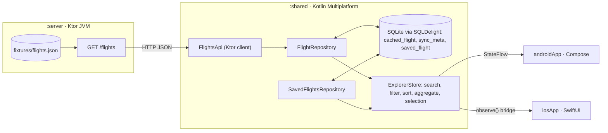
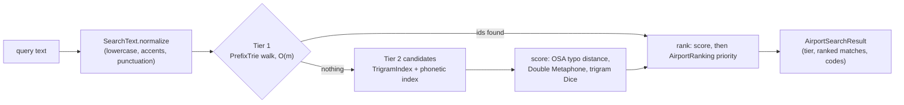

# Architecture

**Principle: shared decides, platforms draw.** Everything with a rule lives once in KMP: fetching, caching, search, filters, ordering, map grouping, selection, saved flights, and the offline state. SwiftUI and Compose render one immutable `ExplorerState` and send intents back. If a platform UI contains an `if` about flight data, that logic belongs in `shared`.

## 1. System overview



## 2. Modules

| Module | Kind | Contents |
|---|---|---|
| `:server` *(new)* | Kotlin/JVM app (Ktor server + `application` plugin) | `GET /flights` |
| `:shared` | KMP library: Android library + static `Shared.framework` | Domain, data, presentation state |
| `:androidApp` | Android app (Compose, Material 3) | UI only |
| `iosApp/` | Xcode project (SwiftUI, iOS 17, Swift 6) | UI only. Its build phase runs `./gradlew :shared:embedAndSignAppleFrameworkForXcode`. |

KMP targets are the existing `android`, `iosArm64`, `iosSimulatorArm64` and `iosX64`, **plus a new `jvm()`**. The JVM target only exists so that `./gradlew :shared:jvmTest` runs fast on any OS, with an in-memory SQLite driver. It is never shipped.

## 3. Shared package layout

```
shared/src/
  commonMain/kotlin/travel/roame/takehome/
    model/          Flight, Airport, FlightFilters, FilterOptions, ActiveFilter, FetchError
    domain/         FlightFilter, Ordering, MapAggregator, ActiveFilters, GreatCircle,
                    PointsFormat                       ← pure functions, no IO, no coroutines
    domain/search/  AirportSearchEngine, PrefixTrie, Similarity (trigrams, edit distance),
                    SearchText, AirportRanking         ← implemented (§4.4)
    vendor/commonscodec/  DoubleMetaphone              ← third-party port (Apache-2.0), see §4.4
    data/remote/    FlightsApi, FlightsEnvelopeDto, FlightDto, error mapping
    data/local/     DriverFactory (expect), FlightCacheDao, SavedFlightDao
    data/           FlightRepository, SavedFlightsRepository (interfaces + impls)
    presentation/   ExplorerStore, ExplorerState, FlightItem, SavedFlightItem,
                    DestinationMarker, DataStatus, UserMessage
    di/             AppGraph                            ← the single composition root
  commonMain/sqldelight/travel/roame/takehome/db/
    CachedFlight.sq  SyncMeta.sq  SavedFlight.sq
  androidMain/      DriverFactory(context), OkHttp engine
  iosMain/          DriverFactory(), Darwin engine, ios/ExplorerStoreIos.kt (Swift bridge)
  jvmMain/          DriverFactory (JdbcSqliteDriver), engine for completeness
  commonTest/       rule tests, fakes, builders
  jvmTest/          fixture contract tests; DoubleMetaphoneOracleTest (port vs the commons-codec jar)
```

## 4. State & data flow

### 4.1 State

```kotlin
data class ExplorerState(
    val data: DataStatus,                 // Loading | Unavailable(error) | Ready(lastSuccessAt, isRefreshing, refreshError?)
    val originQuery: String,
    val destinationQuery: String,
    val filters: FlightFilters,           // dateStart?, dateEnd?, cabin?, maxPoints?, programs: Set<String>
    val options: FilterOptions,           // date bounds, points bounds, cabins, programs (from the whole cache, F8)
    val activeFilters: List<ActiveFilter>,
    val hasAnythingToReset: Boolean,
    val results: List<FlightItem>,        // search → filter → sort (O1), isSaved resolved (V3)
    val markers: List<DestinationMarker>, // from `results` (M1); each carries its flights in O2 order
    val selected: FlightItem?,            // discovery selection, shared by list and map (L1)
    val saved: List<SavedFlightItem>,     // O3, ignores filters (V8), has isListed flag (V4)
    val savedSelected: SavedFlightItem?,  // L7
    val pendingWriteIds: Set<String>,     // save/remove in flight → disable button (V7)
    val messages: List<UserMessage>,      // one-shot errors; the UI calls messageShown(id)
)
```

`DataStatus` encodes the offline rules directly:

- `Loading`: nothing cached yet and the first fetch is running.
- `Unavailable(error)`: nothing has ever synced and the fetch failed. The UI shows a full-screen error (R7).
- `Ready(lastSuccessAt, isRefreshing, refreshError)`: at least one sync has succeeded. An empty `results` list here means either "synced empty" (R4) or "filtered empty", and the UI tells them apart by checking whether the cache itself is empty (`options.isEmpty`).

### 4.2 Intents (store API)

| Group | Methods |
|---|---|
| Search | `setOriginQuery(text)`, `setDestinationQuery(text)` |
| Filters | `setDateRange(startIso?, endIso?)`, `setCabin(cabin?)`, `setMaxPoints(points?)`, `toggleProgram(name)`, `clearFilter(kind)`, `resetAll()` |
| Selection | `select(flightId?)`, `selectSaved(flightId?)` |
| Saved | `toggleSave(flightId)`, `removeSaved(flightId)` |
| Data and messages | `refresh()`, `messageShown(id)` |

Every intent is a plain, non-suspending function, so it is easy to call from Swift. Intents that need IO launch work in the store's scope.

### 4.3 Pipeline

```kotlin
private val inputs = MutableStateFlow(ExplorerInputs())  // queries, filters, selection ids, pending ids, messages

val state: StateFlow<ExplorerState> = combine(
    flightRepository.cache.map(::index),  // CacheSnapshot → IndexedFlights: normalised search keys computed once
    flightRepository.syncStatus,          // Idle | Refreshing | Failed(FetchError)
    savedRepository.saved,                // Flow<List<SavedFlight>>
    inputs,
) { cache, sync, saved, input -> Snapshot(cache, sync, saved, input) }
    .mapLatest(::reduce)                  // pure; cancelled if newer input arrives → latest wins (PERF-3)
    .onEach(::clearStaleSelection)        // L3: write selectedFlightId = null back to inputs
    .flowOn(Dispatchers.Default)
    .stateIn(scope, SharingStarted.Eagerly, ExplorerState.Initial)
```

- `reduce` is a pure function, so it can be unit-tested without coroutines. On 1,000 flights it runs in about a millisecond, so search needs no debounce. Add a debounce of about 100 ms only if profiling shows a problem.
- The search index is rebuilt only when the cache emits, never on each keystroke.
- `Dispatchers.Default` keeps the CPU work off the main thread. `stateIn` hands the result to collectors.

### 4.4 Search engine

**Status:** implemented and tested in `shared`. It isn't wired into a store or screens yet. The rules are in DOMAIN_RULES §2 and §2b. The design is the owner's (D11–D17); D18 and D19 are Claude's details.



| Component | Role | Cost |
|---|---|---|
| `SearchText` | One normalisation shared by the query and the index (S1) | O(query length) |
| `PrefixTrie` | Node-by-node walk with airport ids precomputed per node; `completions()` for autocomplete (S4) | Lookup O(m); memory O(total length of the keys) |
| `TrigramIndex` | Inverted index trigram → terms; Dice similarity from shared counts (S9) | O(trigrams in the query × posting length) |
| `editDistance` | Optimal String Alignment with an early exit once over budget (S7) | O(len²) on candidates only |
| `DoubleMetaphone` (vendored) | Phonetic codes, primary + alternate, length 6 (S8) | O(len) per word, precomputed for the index |
| `AirportRanking` | Proximity + volume priority per airport, with the `flights.json` fallback (P1–P6) | Precomputed per airport; an O(1) lookup |
| `AirportSearchEngine` | Builds the indexes once per dataset and side; `search()` has no side effects | — |

**Data sources for ranking.**
- **Passenger volume** comes from `fixtures/airports.json` (`{"airports":[{"code","annualPassengers"}…]}`). The plan is to serve it as `GET /airports` (M1) and to cache it like flights (M2). When it is missing, a 404 or a decode failure means volume = flight counts from `flights.json` (P4).
- **User location** comes from the device (D16), through a small platform `LocationProvider` that returns `GeoPoint?`: Fused Location Provider on Android, Core Location on iOS, at approximate accuracy. It is requested only when the user taps "Use my location". The shared code only ever sees an optional point; `null` means ranking by volume only. There is no geo-IP endpoint and no third party.

**Third-party code.** `vendor/commonscodec/DoubleMetaphone.kt` is a Java → Kotlin translation of Apache Commons Codec 1.23.0 (Apache-2.0). It is **not our own algorithm**: we didn't design it and don't claim to understand every rule in it. Its correctness is established by the `jvmTest` oracle, which compares it with the original jar. See SUBMISSION_NOTES §8 and THIRD_PARTY_NOTICES.md.

## 5. Persistence (SQLDelight)

The database file is `roame.db`, at schema version 1, with no migrations.

```sql
-- CachedFlight.sq
CREATE TABLE cached_flight (
  id TEXT NOT NULL PRIMARY KEY,
  origin TEXT NOT NULL, origin_city TEXT NOT NULL, origin_lat REAL NOT NULL, origin_lon REAL NOT NULL,
  destination TEXT NOT NULL, destination_city TEXT NOT NULL, destination_lat REAL NOT NULL, destination_lon REAL NOT NULL,
  departure_date TEXT NOT NULL,          -- ISO yyyy-MM-dd
  program TEXT NOT NULL,
  points INTEGER NOT NULL,
  cabin TEXT NOT NULL
);

-- SyncMeta.sq  (single row; absent = never synced, R8)
CREATE TABLE sync_meta (
  id INTEGER NOT NULL PRIMARY KEY CHECK (id = 0),
  last_success_at INTEGER NOT NULL       -- epoch millis
);

-- SavedFlight.sq  (same flight columns as cached_flight, plus:)
--   saved_at INTEGER NOT NULL
```

**Refresh transaction (R3 + V5):**

```kotlin
withContext(io) {
    db.transaction {
        cachedFlightQueries.deleteAll()
        flights.forEach(cachedFlightQueries::insert)
        syncMetaQueries.upsertLastSuccess(now)               // INSERT OR REPLACE on the single row
        flights.forEach(savedFlightQueries::updateDetailsWhereIdMatches)
    }
}
```

**Upsert without `ON CONFLICT … DO UPDATE` (V2).** `minSdk` is 23, and the platform SQLite on old Android versions predates SQLite's UPSERT syntax (3.24). Use two statements in one transaction: `INSERT OR IGNORE …`, then `UPDATE … WHERE id = ?`. This keeps `saved_at` and works on every SQLite version. Avoid `INSERT OR REPLACE` for saved rows, because it deletes and re-inserts the row and resets `saved_at`.

**Reads** go through `asFlow().mapToList(io)`, from SQLDelight's coroutines extensions, so they never run on the main thread.

## 6. Networking & the local API

### 6.1 Contract

`GET /flights` returns `200 application/json` with `{"flights": [Flight…]}`. The field names match the fixture exactly (camelCase).

### 6.2 Server (`:server`)

- Ktor server (Netty or CIO) listening on `0.0.0.0:8080`. The port can be overridden with the `PORT` env var.
- Each request reads `fixtures/flights.json` and returns **the raw bytes**, with no re-serialisation, so the response is byte-identical to the fixture (API-1). Reading on every request means you can edit the fixture while the server runs to test refresh, V4 and V5.
- The fixture path defaults to `<repo>/fixtures/flights.json` and can be overridden with `--fixture=<path>`. Set `tasks.named<JavaExec>("run") { workingDir = rootDir }` so relative paths work. If the file is missing, fail fast at startup.
- An optional QA switch, `--mode=normal|empty|error|slow`, selects one of these behaviours:
  - `empty` returns `{"flights":[]}` with 200.
  - `error` returns 503.
  - `slow` adds a 3 s delay.

  Use it like this:
  ```
  ./gradlew :server:run --args="--mode=empty"
  ```
  This is not part of the required contract. It exists to demo and QA R4, R5 and R7.
- Request logging uses Ktor's `CallLogging` plugin.
- *Planned with the search ranking:* `GET /airports` serves `fixtures/airports.json` the same way, as raw bytes. If the file is absent, it returns 404, and the app falls back to flight counts (DOMAIN_RULES P4). It is optional and never required for the app to work.

### 6.3 Client (`FlightsApi`)

- A Ktor `HttpClient` with these plugins:
  - `ContentNegotiation(json { ignoreUnknownKeys = true })`
  - `HttpTimeout(connect = 5s, request = 15s)`
- `expectSuccess = false`; the status code is checked explicitly.
- Engines: OkHttp on Android, Darwin on iOS, and `MockEngine` in tests.
- Exceptions are mapped to `FetchError` (R9):

  | Cause | `FetchError` |
  |---|---|
  | `HttpRequestTimeoutException`, connect or socket timeout | `Timeout` |
  | Connection refused, unreachable host, DNS failure, no network. Detect this per platform with `expect fun Throwable.isConnectivityFailure()`: Android uses `java.io.IOException` subtypes, iOS uses `NSURLErrorDomain` codes such as -1004 and -1009. | `Offline` |
  | Non-2xx status | `Server(status)` |
  | `SerializationException`, `IllegalArgumentException` from date parsing, or a missing field | `InvalidData` |
  | `CancellationException` | **rethrown, never mapped** (R12) |
  | Anything else | `Unknown` |

### 6.4 Base URL & cleartext HTTP

| Platform | Default base URL | Configured in | Platform setup required |
|---|---|---|---|
| Android emulator | `http://10.0.2.2:8080` | `BuildConfig.API_BASE_URL` (`buildFeatures { buildConfig = true }`) | Add `<uses-permission android:name="android.permission.INTERNET"/>`, which the starter manifest **lacks**. Add `res/xml/network_security_config.xml` that allows cleartext traffic to `10.0.2.2` and `localhost` only. |
| iOS simulator | `http://localhost:8080` | Info.plist key `API_BASE_URL` | Add `NSAppTransportSecurity › NSAllowsLocalNetworking = YES`. |
| Physical devices | The Mac's LAN IP | Same keys | Android: add the IP to the network security config. iOS: add `NSLocalNetworkUsageDescription`. |

The platform passes the base URL into `AppGraph`. Shared code never hardcodes a host.

## 7. Concurrency & lifecycle

| Work | Dispatcher |
|---|---|
| Intents and state collection | `Dispatchers.Main.immediate` (the store scope) |
| Reduce, search index, aggregation | `Dispatchers.Default` |
| SQLite reads and writes | `Dispatchers.IO` (`kotlinx.coroutines.IO` on Native) |
| HTTP | Ktor engine threads (`suspend`) |

- `AppGraph` is created **once per process** and owns `CoroutineScope(SupervisorJob() + Dispatchers.Main.immediate)`. Because the store is app-scoped, Android rotation or configuration changes never lose state, and there are no per-screen stores to leak.
- UI observers are the only things that come and go. Compose uses `collectAsStateWithLifecycle`, and Swift cancels its `Cancellable` (§8).
- Tests inject dispatchers and a `Clock`, and use `runTest` with `StandardTestDispatcher` plus `Dispatchers.setMain`.
- Debug builds enable Android `StrictMode` (detect disk reads, disk writes and network on the main thread, with `penaltyLog`) to prove PERF-2.

## 8. iOS interop

Kotlin `Flow` and `suspend` functions do not map cleanly to Swift 6. Swift only ever sees one small hand-written bridge in `iosMain`:

```kotlin
// shared/src/iosMain/kotlin/travel/roame/takehome/ios/ExplorerStoreIos.kt
class ExplorerStoreIos internal constructor(private val store: ExplorerStore) {
    val state: ExplorerState get() = store.state.value
    fun observe(onChange: (ExplorerState) -> Unit): Cancellable {
        val job = MainScope().launch { store.state.collect { onChange(it) } }   // delivered on main
        return Cancellable { job.cancel() }
    }
    fun setOriginQuery(text: String) = store.setOriginQuery(text)
    fun setDateRange(startIso: String?, endIso: String?) = store.setDateRange(startIso, endIso)
    // … one plain method per intent
}
fun interface Cancellable { fun cancel() }
```

```swift
@MainActor @Observable
final class ExplorerModel {
    private(set) var state: ExplorerState
    let store: ExplorerStoreIos
    @ObservationIgnored private var subscription: Cancellable?

    init(store: ExplorerStoreIos) {
        self.store = store
        self.state = store.state
        subscription = store.observe { [weak self] newState in
            MainActor.assumeIsolated { self?.state = newState }   // Kotlin delivers on the main thread
        }
    }
}
```

Rules for the Swift-facing API:

- No default arguments relied on from Swift, no generics, and no `suspend` or `Flow` in public signatures.
- UI models (`FlightItem` and similar) expose primitive-friendly fields: `String`, `Int`, `Double`, `Bool`, and ISO date strings rather than `LocalDate`.
- Sealed types (`DataStatus`, `FetchError`) appear in Swift as class hierarchies. Switch on them with `case let x as DataStatus.Ready`.
- `Shared` is a **static** framework, so add `-lsqlite3` to the app target's `OTHER_LDFLAGS` for SQLDelight's native driver.
- Optional: use **SKIE** (Touchlab), which gives Swift enums and `AsyncSequence`, but only if a release supports Kotlin 2.4.21. Check that first; otherwise keep the bridge above.

The app creates `AppGraph` once in `@main struct … : App`, and passes the model down through `.environment(model)`.

**Location (D16).** Core Location with `requestWhenInUseAuthorization()`, triggered only by "Use my location". Add `NSLocationWhenInUseUsageDescription` to `Info.plist`; approximate (reduced) accuracy is enough. A single `requestLocation()` result goes to the store as latitude/longitude. In the simulator, set a location via Features › Location.

## 9. Android integration

- `RoameApp : Application` builds `AppGraph(DriverFactory(this), BuildConfig.API_BASE_URL)`. Register it in the manifest.
- Screens read `app.graph.explorerStore.state.collectAsStateWithLifecycle()`. There is no Android `ViewModel` layer, because the shared store already outlives configuration changes.
- Navigation uses `rememberSaveable` tab state. Two tabs don't need a navigation library.
- Lists use `LazyColumn(items(results, key = { it.id }))`, with stable and immutable models (`@Immutable` where helpful).
- Add these dependencies: `material3`, `lifecycle-runtime-compose`, MapLibre (D8), and `leakcanary-android` (debug only).
- **Location (D16):**
  - Fused Location Provider comes from Google Play services (`com.google.android.gms:play-services-location`), so the emulator needs a "Google Play" or "Google APIs" system image.
  - Declare `ACCESS_COARSE_LOCATION` and request it only when the user taps "Use my location".
  - Read one location with `getCurrentLocation(PRIORITY_BALANCED_POWER_ACCURACY)` and pass it to the store as a `GeoPoint`.

## 10. Libraries

The per-choice tradeoffs (options, strengths, weaknesses, who chose and why) are in [SUBMISSION_NOTES.md §4](SUBMISSION_NOTES.md#4-technical-tradeoffs-by-stack-choice).

Pin versions in a new `gradle/libs.versions.toml`, and choose versions compatible with **Kotlin 2.4.21, AGP 9.3.1 and Gradle 9.7** at implementation time.

| Concern | Choice | Why | Fallback |
|---|---|---|---|
| Async | kotlinx-coroutines (+ `-test`) | Standard; `Flow`, `mapLatest`, `runTest` | — |
| JSON | kotlinx-serialization-json (+ plugin) | KMP-native, compile-time | — |
| Dates | kotlinx-datetime `LocalDate` | Calendar dates with no timezone traps | ISO strings, which compare correctly as text |
| HTTP client | Ktor client: core, content-negotiation, okhttp, darwin, mock | The standard KMP client; `MockEngine` for tests | — |
| Database | SQLDelight 2.x: runtime, coroutines-extensions, android/native/sqlite drivers | Typed SQL, Flow queries, mature KMP drivers, JVM in-memory driver for tests | Room KMP (bundled SQLite driver), then a JSON file with atomic writes |
| Server | Ktor server (Netty/CIO) in `:server` | Same language and build, so `./gradlew :server:run` is the single command | A ~20-line Node or Python script |
| Flow testing | Turbine | Readable Flow assertions | Collect into lists manually |
| iOS bridge | Hand-written `observe()` wrapper | No dependency on Kotlin-version-specific plugins | SKIE, if compatible |
| iOS map | MapKit for SwiftUI (`Map`, `Annotation`, `MapPolyline(…, contourStyle: .geodesic)`) | Built in, iOS 17, no API key | — |
| Android map (D8) | **MapLibre Native Android** with OpenFreeMap tiles, no API key | Reviewers can run it with no setup | Google Maps Compose (needs an API key), only with the owner's approval if MapLibre fails |
| Device location *(D16)* | Android: Fused Location Provider (`play-services-location`). iOS: Core Location (built in) | Works offline, no third party | — |
| Leaks | LeakCanary (Android debug), Xcode Memory Graph and Leaks instrument | — | — |
| Phonetic matching | **Vendored** Double Metaphone: a Kotlin port of Apache Commons Codec 1.23.0, Apache-2.0 | No KMP library exists, and commons-codec is JVM-only (no iOS) | — |
| Port verification | `commons-codec:commons-codec:1.23.0`, **test-only** (`jvmTest`) | The original library acts as the oracle for the port | — |
| Other search algorithms | Our own code: trie, trigram index, OSA edit distance, ranking | Small, explainable, tested | — |

## 11. Decision log

The rationale and the rejected alternatives for each decision. **Origin** and **status** match the decision record in [SUBMISSION_NOTES.md §2](SUBMISSION_NOTES.md#2-decision-record). "Claude" means Claude's choice of *how* to meet a brief requirement; it isn't a requirement in itself.

| # | Decision | Origin | Why | Rejected alternatives |
|---|---|---|---|---|
| D1 | The local API is a Ktor JVM module in the same Gradle build | Claude; awaiting review | One language and one command. It reuses the Gradle and JDK setup that already exists. | Node or Python, which add a runtime dependency for reviewers |
| D2 | Share **presentation state** (`ExplorerStore`), not just repositories | Claude; awaiting review | Selection, map grouping, active filters and offline state then behave identically on both platforms and are unit-tested once | Separate per-platform view models over shared repositories, which duplicates rules |
| D3 | SQLite via SQLDelight | Claude; awaiting review | Transactions for atomic cache replacement, upsert for saved flights, reactive queries, and in-memory JVM tests | DataStore or JSON files: no transactions or queries. Room KMP is a close second. |
| D4 | Saved flights are snapshots in their own table | Claude; awaiting review | They survive being missing from the API response (V4) and cache wipes | A saved-ids table joined to the cache, which loses flights that vanish from the API |
| D5 | Replace the whole cache on every successful refresh | Claude; awaiting review | The API returns the full dataset with no paging or diff, so a full replace is simplest and correct | Merge or diff, which is unnecessary complexity |
| D6 | Filter in memory on `Dispatchers.Default`, not in SQL | Claude; awaiting review | Only 1,000 rows. Pure functions are easier to test, and there is one code path. | SQL `WHERE` clauses, which are harder to compose and to test for boundaries |
| D7 | A hand-written Swift bridge | Claude; awaiting review | No plugin coupled to Kotlin 2.4.21 | SKIE or KMP-NativeCoroutines, which carry version risk |
| D8 | **MapLibre** on Android (MapKit on iOS) | Owner's choice (Claude's recommendation) | Open source with no API key, so the map works for any reviewer. GPU-drawn vector tiles give smooth, sharp rendering, and we don't target low-end phones, so a lighter library buys nothing | Google Maps Compose (mandatory Google Cloud billing account and API key; reviewers without one see a blank map); osmdroid (raster tiles in a classic View, with known visual glitches) |
| D9 | Add a `jvm()` target for tests | Claude; built, awaiting review | Fast `jvmTest` runs on any machine and in CI, with a real SQLite in memory | Android host tests, which are slower and awkward under the new AGP 9 KMP plugin |
| D10 | One app-scoped store per process | Claude; awaiting review | It survives rotation, avoids leaks, and gives one source of truth for list and map | Per-screen view models, which risk divergent state |
| D11 | **Tiered search:** walk a prefix tree node by node in O(m); fuzzy only when the prefix tier finds nothing | **Owner** | Predictable while typing; fuzzy never adds noise to good prefix results | A blended score over every signal (it passed the same tests but is less predictable) |
| D12 | **Fuzzy = phonetic + n-gram + accent folding**, built on the owner's four mistyping cases; Claude added an edit-distance typo signal | **Owner** (+ Claude) | Covers typos, sound-alike spellings, partial spellings and accents | Prefix only (no tolerance); Soundex (misses `shicago`, `okland`) |
| D13 | **Double Metaphone comes from a library** (Apache Commons Codec), translated to Kotlin with credit and verified against the jar | **Owner** (a library, disclosed); translation route: owner's choice | No KMP library exists, and the Java one can't run on iOS. A port keeps one shared implementation. | Android-only library (platforms would diverge); our own Metaphone-lite |
| D14 | A **"Showing … (CODE)" hint** when results come from fuzzy matching | Owner's choice | Silent corrections confuse people | A suggestions dropdown (more UI work); silent |
| D15 | **Ranking by location + passenger volume.** Volume lives in a separate `fixtures/airports.json`, with a fallback to flight counts from `flights.json` | **Owner** | Familiar and nearby airports first, without touching the provided data | Editing `flights.json` (rejected: the API must serve it verbatim) |
| D16 | **Location comes from the device** (Fused Location Provider / Core Location), approximate accuracy, only on "Use my location" | **Owner** | Works offline (GPS needs no internet), more accurate, no third party, no extra endpoint | Geo-IP through the local API (Claude's earlier proposal): it would locate the developer's machine rather than the user, and needs an outside geo-IP service |
| D17 | **Ranking only orders the matched airports.** The flight list keeps O1 | Owner's choice (option A) | Earlier and cheaper flights are never pushed down; the list order doesn't depend on where you are | Reordering the flight list by airport priority (option B) |
| D18 | Search runs on **airports, not flights**, behind indexes | Claude; built, awaiting review | Search cost doesn't grow with the number of flights (SCALE-1) | Matching each flight's strings |
| D19 | Ranking weights: origin 0.7 / 0.3, destination 0.2 / 0.8 | Claude; assumption A13, awaiting review | You fly *from* near you; *where* you go is mostly about popularity | Equal weights for both fields |

## 12. Scalability

The fixture is small (1,000 flights, 32 airports), but every layer has a known cost and a known next step. **Current** is what we build. **Next step** is what changes when the limit is reached; it is not built unless needed. The limits are *estimates* until the M6 benchmarks (TEST_PLAN §4.1) measure them; the measured numbers go in SUBMISSION_NOTES §6.

| Layer | Current design | Cost per operation | Comfortable up to (est.) | Next step beyond that |
|---|---|---|---|---|
| Local API | Returns the whole fixture on every request | O(n) bytes (~430 KB today) | ~10k flights (~4 MB) | gzip; `ETag` / `If-None-Match` → 304; pagination or delta sync (`?since=`) |
| Cache (SQLite) | Full replace in one transaction | O(n) batched inserts | ~100k rows | Diff: upsert changed rows and delete missing ones; indexes on `departure_date`, `origin`, `destination`, `points` |
| Filter / sort pipeline | In memory, pure functions, `mapLatest` on `Dispatchers.Default` | O(n) filter + O(k log k) sort per input change | ~100k flights | Push predicates into indexed SQL that returns ids; page the results |
| Text search (§4.4) | Trie (O(m)) + inverted trigram and phonetic indexes over **airports**; flights are then filtered by code | Prefix O(m); fuzzy O(candidates × len²) | Thousands of airports (est. well under 1 ms per keystroke) | Cap the ids stored per trie node to the top K by priority; move fuzzy candidate generation server-side; fuzzy over flights is never needed |
| Map aggregation | Group results by destination | O(n) | ~200 markers render individually | Cluster markers by zoom level; aggregate with SQL `GROUP BY` |
| State → UI | One immutable `ExplorerState` holding full lists | O(n) per emission | ~10k rows | Page or window the lists (Paging 3 / chunked windows); keep ids in state and load rows lazily |
| Saved flights | Snapshot table | O(saved) | 10k+ | Paging in the Saved tab |
| Memory | Dataset + indexes in memory | A few MB at 1k flights | ~100k flights (tens of MB, est.) | Keep rows in SQLite and hold only windows plus indexes in memory |

Two principles make the "next step" column cheap to reach:

- **Rules are pure functions with tests** (DOMAIN_RULES). Moving a filter from memory into SQL keeps its rule ID and its test table. Only the implementation behind the interface changes.
- **Ordering always has a deterministic tiebreak** (O1–O3), so paging can be added without rows jumping between pages.
